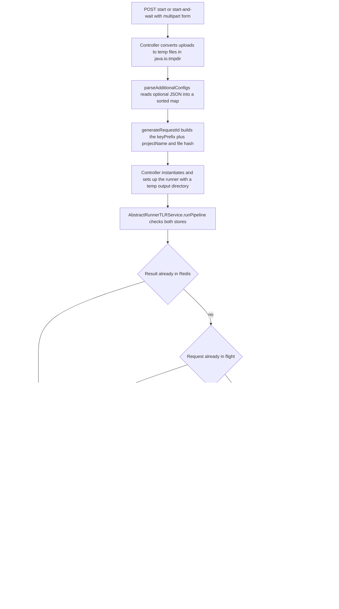

# Architecture

ArDoCo REST is a layered Spring Boot application built around a consistent controller → service → repository flow. Controllers own the HTTP boundary (multipart handling, request-ID generation, runner setup), runner-backed services own the dedup decision, asynchronous execution, and result conversion, and repositories provide two deliberately separate stores: volatile in-flight tracking and durable Redis persistence.

## Application bootstrap

`ArDoCoRestApplication` is annotated with `@SpringBootApplication(exclude = { DataSourceAutoConfiguration.class })`, `@EnableAsync`, and `@OpenAPIDefinition` metadata ("ARDoCo: Trace Link Recovery"). Excluding `DataSourceAutoConfiguration` means the application starts without any SQL datasource — all durable state lives in Redis (see [Redis persistence integration](integrations/redis.md)). `@EnableAsync` turns on Spring's async infrastructure at the application level, although the pipelines themselves are dispatched with `CompletableFuture.supplyAsync` inside `AbstractRunnerTLRService`, not through `@Async` handler methods.

`ApplicationConfig` declares `@EnableRedisRepositories` and defines the `LettuceConnectionFactory` and `RedisTemplate` beans from the `spring.data.redis.host` and `spring.data.redis.port` properties. `WebConfig` registers `ModelFormatTypeConverter` as a Spring converter so the `inputArchitectureModelFormat` request parameter binds directly to the `ModelFormat` enum; an unknown format name surfaces as an `IllegalArgumentException`.

## Layering overview

| Layer | Responsibility | Classes |
| --- | --- | --- |
| Controller | HTTP boundary, file conversion, request IDs, runner setup, response shaping | `AbstractController` plus the five family controllers, `ResultController`, `HomeController`, `HealthController`, `ConfigurationProviderController` |
| Service | dedup decision, async pipeline execution, result lookup/waiting, result conversion | `AbstractService`, `AbstractRunnerTLRService`, `ResultService`, five concrete runner services |
| Repository | in-flight tracking and durable key-value storage | `CurrentlyRunningRequestsRepository`, `DatabaseAccessor`, `RedisAccessor` |

## Controller layer

### AbstractController

`AbstractController` holds the constants for the shared multipart parameters (`projectName`, `inputText`, `inputArchitectureModel`, `inputArchitectureModelFormat`, `inputCode`, `additionalConfigs`), the `TraceLinkType` and the `AbstractRunnerTLRService` for its family, and an autowired `ResultService`. It provides the shared behavior all family controllers reuse:

- `handleRunPipeLineResult(runner, requestId, inputFiles)` calls `service.runPipeline(...)`. If no result came back it answers `200 OK` with the message "The result is being processed and can be queried using the id."; if a cached result was returned it answers `200 OK` with the payload and "The result is ready." Both outcomes are HTTP 200 — the ID is the contract for later polling.
- `handleRunPipelineAndWaitForResult(runner, requestId, inputFiles)` performs the same service call, then (when empty) blocks in `ResultService.waitForResult(requestId)`. It answers `200 OK` with the result when one arrives in time, otherwise `202 Accepted` with "The request timed out before the traceLinks could be retrieved. Please try querying only the result using the projectId."
- `generateRequestId(files, projectName)` builds the content-based request ID (see [Request IDs and result caching](concepts/request-ids-and-caching.md)).
- `parseAdditionalConfigs(additionalConfigsJson)` parses the optional JSON string into a sorted map (`TreeMap<String, String>`); invalid JSON raises `FileConversionException`.

### Runner setup happens in the controllers (documented trade-off)

Every start endpoint follows the same sequence inside the controller: convert the multipart uploads to local `File` objects, parse the optional config JSON, generate the request ID, and then **instantiate and configure the ArDoCo runner itself** — `new Ardocode(projectName)` plus `runner.setUp(...)` in `ArDoCodeController`, and equivalents in `ArCoTLController`, `SwattrController`, `TransArCController`, and `InconsistencyController`. The runner's required output directory is a throwaway temp directory (`Files.createTempDirectory("ardoco-...")`), because results are returned via the API rather than as output files.

This placement is a documented trade-off in [architecture_decisions.md](../architecture_decisions.md): the runner is set up in the controller *before* the service decides whether the run is even needed, so ArDoCo is partially invoked in the controller layer and the runner is always set up for the `runPipeline` methods — even when the result is already in the database and only needs to be read back. The alternative (setting the runner up in the service layer, after the cache check) was rejected because each runner's `setUp` method takes different parameters, so a unified service interface would require substantial generics complexity. Anyone refactoring the service layer must keep this in mind: moving the dedup check "earlier" means moving runner construction with it, or accepting that setup cost is paid on every request.

Only the direct interaction with ArDoCo is asynchronous; input conversion, hashing, and runner setup run synchronously in the request thread so clients get fast feedback when an input file is missing or empty. No file-type validation happens in the REST layer — that is delegated to ArDoCo itself; the API only rejects empty files.

### Runner families and endpoints

Each ArDoCo runner is represented by one controller with a `/start` and a `/start-and-wait` endpoint:

| Controller | Base path | `TraceLinkType` | Runner class | Required multipart inputs |
| --- | --- | --- | --- | --- |
| `ArDoCodeController` | `/api/ardocode` | `SAD_CODE` (`ardocodeResult`) | `Ardocode` | text, code |
| `ArCoTLController` | `/api/arcotl` | `SAM_CODE` (`arcotlResult`) | `Arcotl` | architecture model + format, code |
| `SwattrController` | `/api/swattr` | `SAD_SAM` (`swattrResult`) | `Swattr` | text, architecture model + format |
| `TransArCController` | `/api/transarc` | `SAD_SAM_CODE` (`transarcResult`) | `Transarc` | text, architecture model + format, code |
| `InconsistencyController` | `/api/find-inconsistencies` | `SAD_SAM` (`swattrResult`) | `InconsistencyDetection` | text, architecture model + format |

`InconsistencyController` overrides `generateRequestId` to produce `swattrResultInconsistency:<projectName><hash>` instead of the plain `swattrResult:` prefix, so inconsistency results are keyed separately from plain SWATTR results while reusing the same `TraceLinkType`.

### Retrieval and utility controllers

`ResultController` exposes `/api/get-result/{id}` and `/api/wait-for-result/{id}`. These endpoints are cross-family: because IDs embed the `TraceLinkType` prefix and `TraceLinkType.fromId` matches on that prefix, any family's result can be retrieved through these two endpoints regardless of which start endpoint produced it. `HomeController` redirects `/` to the Swagger UI, `HealthController` serves `/api/health`, and `ConfigurationProviderController` serves `/api/configuration`, where `ConfigurationProviderService` uses reflection over `AbstractConfigurable` subclasses to return ArDoCo's default configuration keys and values — a map clients can feed back as `additionalConfigs`.

## Service layer

The services form a three-level inheritance structure: `AbstractService` is the root, `ResultService` and `AbstractRunnerTLRService` inherit from it, and each runner family has its own concrete subclass of `AbstractRunnerTLRService`.

### AbstractService

`AbstractService` owns the shared lookup logic against both stores:

- `resultIsInDatabase(id)` — durable-storage existence check via `DatabaseAccessor.keyExistsInDatabase`.
- `resultIsOnItsWay(id)` — in-flight check via `CurrentlyRunningRequestsRepository.containsRequest`.
- `getResultFromDatabase(id)` — throws `IllegalArgumentException` ("No result with key … found.") when the key is absent; throws `ArdocoException` when the stored value is `null` or starts with the `ERROR_PREFIX` (`"Error: "`); otherwise re-parses the stored JSON into an `ArDoCoApiResult` by extracting its `traceLinks` and `inconsistencies` fields.

### AbstractRunnerTLRService

`AbstractRunnerTLRService` contains the pipeline-start logic:

- `runPipeline(runner, id, inputFiles)` starts a new run only when the result is neither already in Redis nor currently in flight. It wraps `runPipelineAsync` in a `CompletableFuture.supplyAsync` (ForkJoin common pool) and registers that future under the request ID in `CurrentlyRunningRequestsRepository`. When the result is already stored, it returns it directly; otherwise it returns `Optional.empty()`, which the controller turns into the "being processed" response. The check-then-act sequence is not atomic, so two concurrent first requests for the same brand-new ID can each dispatch a run before either future is registered.
- `runPipelineAsync(...)` runs `runner.run()`, converts the `ArdocoResult` via the abstract `convertResultToJsonString(result)`, and stores the raw JSON string with `databaseAccessor.saveResult(id, result.buildJsonString())`.
- On any exception it stores `ERROR_PREFIX + message` (i.e., a value beginning with `"Error: "`) in Redis and rethrows `ArdocoException`. A failed pipeline therefore leaves a retrievable error marker instead of a missing key — later `getResult` calls surface it as an `ArdocoException` (HTTP 500).
- A `finally` block always removes the in-flight entry and deletes all temporary input files, on both success and failure paths.

### ResultService

`ResultService` (not tied to a runner) implements result retrieval for all families:

- `getResult(id)` returns `Optional.empty()` while the request is still in flight — avoiding an unnecessary database call — and otherwise reads from Redis via `getResultFromDatabase`.
- `waitForResult(id)` blocks on the registered `CompletableFuture` with `future.get(secondsUntilTimeout, TimeUnit.SECONDS)` when the request is in flight. `secondsUntilTimeout` comes from `tlr.timeout.seconds` (60 seconds by default). A timeout yields `Optional.empty()` (→ `202 Accepted`); an execution or interruption error is rethrown as `ArdocoException`. When the request is no longer in flight it goes straight to the database, where an unknown ID raises `IllegalArgumentException`.

### Concrete runner services

`ArDoCodeService`, `ArCoTLService`, `SwattrService`, `TransArCService`, and `InconsistencyService` each implement `convertResultToJsonString`, converting the runner-specific trace links through `TraceLinkConverter` into the JSON payload stored in Redis. All of them store an empty `inconsistencies` array except `InconsistencyService`, which additionally converts `result.getAllInconsistencies()` through `InconsistencyConverter` and stores a populated inconsistencies array. (`TransArCService` converts `getSadCodeTraceLinks()`; the sad-code converter enriches `TransitiveTraceLink` entries with the intermediate architecture model element, which is how TransArC's transitive sad-sam-code links are represented.)

## Repository layer

The persistence boundary is split into two parts with different lifetimes:

### In-flight tracking: CurrentlyRunningRequestsRepository

`CurrentlyRunningRequestsRepository` is a singleton-scoped `@Repository` wrapping a `ConcurrentHashMap<String, CompletableFuture<ArDoCoApiResult>>` with `addRequest`, `getRequest`, `containsRequest`, and `removeRequest`. It is purely in-memory application state: registering the futures lets `getResult` avoid database calls for unfinished pipelines and lets `waitForResult` block on the future instead of polling Redis. The map is lost on restart, which is harmless because durable results live in Redis and unfinished pipelines die with the process.

### Durable storage: DatabaseAccessor and RedisAccessor

`DatabaseAccessor` is the interface (`saveResult`, `getResult`, `keyExistsInDatabase`, `deleteResult`) that decouples services from the concrete store so the database can be swapped. `RedisAccessor` is the only implementation, annotated `@Primary`, backed by a `RedisTemplate<String, String>`. It stores values as plain strings (raw JSON payloads or `"Error: "` messages) in a flat key-value table, sets each entry with a TTL taken from `redis.time-to-live.hours` (24 hours by default), and provides lookup, existence check, and deletion. See [Redis persistence integration](integrations/redis.md) for connection setup and operations.

## Request lifecycle

*Request lifecycle of a pipeline-start call through controller, service, and Redis.*

A typical "start pipeline" request therefore moves through: multipart reception → temp-file conversion → ID generation → runner setup → dedup check against Redis and the in-flight registry → asynchronous `runner.run()` → JSON conversion → Redis save → in-flight removal and temp-file deletion. The `start-and-wait` endpoints use the identical setup and then wait for a bounded time before answering `202 Accepted` if the result is still unavailable. Detailed step-by-step behavior lives in [Workflow: pipeline execution](workflows/pipeline-execution.md) and [Workflow: result retrieval and waiting](workflows/result-retrieval.md).

## Request IDs and caching

Request IDs are `traceLinkType.getKeyPrefix() + ":" + projectName + <hash>` where the hash is a `UUID.nameUUIDFromBytes` (MD5-based name UUID) over the concatenated bytes of all input files, produced by `HashGenerator`. Only files, project name, and trace-link type feed the hash — the `additionalConfigs` JSON deliberately does not, so requests that differ only in configuration collide on the same ID and reuse the cached result. This is documented as a known limitation that may be revisited. Because entries expire after 24 hours and the hash space is large enough, collisions among live entries are practically impossible, which makes content-based key reuse safe. See [Request IDs and result caching](concepts/request-ids-and-caching.md) for client-facing consequences.

## Response and error model

Successful responses use the `ArdocoResultResponse` envelope with `requestId`, `status` (serialized as the HTTP status name), a human-readable `message`, `traceLinkType` (derived from the request ID via `TraceLinkType.fromId`), and the optional `result` payload. `ArDoCoApiResult` carries `traceLinks` and `inconsistencies` as `@JsonRawValue` raw JSON strings; `buildJsonString()` defines the exact payload shape stored in Redis, and `AbstractService` re-parses that same shape on retrieval, so the stored and response shapes must stay in sync.

Errors use the `ErrorResponse` shape (timestamp, status, message), produced centrally by `GlobalExceptionHandler`:

| Exception | HTTP status |
| --- | --- |
| `FileNotFoundException` (empty file) | 422 Unprocessable Content |
| `FileConversionException` (conversion / invalid config JSON) | 422 Unprocessable Content |
| `IllegalArgumentException` (unknown result ID, invalid model format) | 422 Unprocessable Content |
| `ArdocoException` (pipeline failure, stored error marker, wait failure) | 500 Internal Server Error |
| `TimeoutException` (custom runtime exception) | 408 Request Timeout |
| any other `Exception` | 500 Internal Server Error |

See [Workflow: result retrieval and waiting](workflows/result-retrieval.md) for how clients experience these paths.

## Operational behavior

- `/` redirects to the Swagger UI.
- OpenAPI metadata is declared on the main application class.
- Async execution is enabled at the application level; pipeline dispatch uses `CompletableFuture.supplyAsync`.
- DataSource auto-configuration is excluded, matching the Redis-backed architecture.
- Stored results have a 24-hour TTL (`redis.time-to-live.hours`), and result waits time out after `tlr.timeout.seconds` (60 s).
- `/api/health` and `/actuator/health` serve as health checks.

## Key source files

- `src/main/java/edu/kit/kastel/mcse/ardoco/tlr/rest/ArDoCoRestApplication.java`
- `src/main/java/edu/kit/kastel/mcse/ardoco/tlr/rest/ApplicationConfig.java`
- `src/main/java/edu/kit/kastel/mcse/ardoco/tlr/rest/api/controller/AbstractController.java`
- `src/main/java/edu/kit/kastel/mcse/ardoco/tlr/rest/api/controller/ResultController.java`
- `src/main/java/edu/kit/kastel/mcse/ardoco/tlr/rest/api/service/AbstractService.java`
- `src/main/java/edu/kit/kastel/mcse/ardoco/tlr/rest/api/service/AbstractRunnerTLRService.java`
- `src/main/java/edu/kit/kastel/mcse/ardoco/tlr/rest/api/service/ResultService.java`
- `src/main/java/edu/kit/kastel/mcse/ardoco/tlr/rest/api/repository/CurrentlyRunningRequestsRepository.java`
- `src/main/java/edu/kit/kastel/mcse/ardoco/tlr/rest/api/repository/DatabaseAccessor.java`
- `src/main/java/edu/kit/kastel/mcse/ardoco/tlr/rest/api/repository/RedisAccessor.java`
- `src/main/java/edu/kit/kastel/mcse/ardoco/tlr/rest/api/exception/GlobalExceptionHandler.java`
- `architecture_decisions.md`
