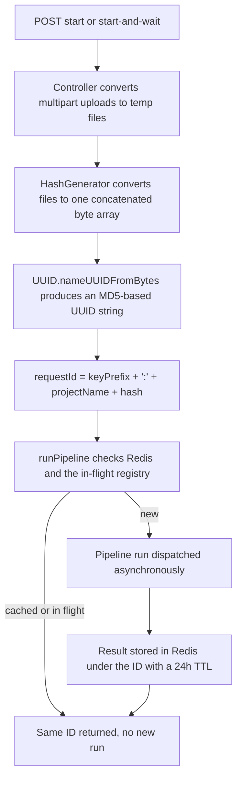

# Request IDs and result caching

Every pipeline-start request in the ArDoCo REST API is identified by a **content-based request ID**. The ID is deterministic: identical inputs always produce the identical ID, and that ID is used both as the Redis key under which the result is stored and as the handle clients use to retrieve the result. This gives the API a built-in caching layer: a re-request with the same inputs does not re-run ArDoCo, it returns the cached result — and if the pipeline is already running for that ID, the client simply gets the same ID back without a second run being dispatched.

## How the request ID is constructed

The ID is built in `AbstractController.generateRequestId(List<File> files, String projectName)`:

```java
String hash = HashGenerator.getMD5HashFromFiles(files);
return traceLinkType.getKeyPrefix() + ":" + projectName + hash;
```

So an ID looks like `<keyPrefix>:<projectName><hash>`, for example
`ardocodeResult:bigbluebutton67c34469-a21a-36dc-94fd-39531c9c1e6c`. The hash is produced by `HashGenerator.getMD5HashFromFiles`, which:

1. Concatenates the raw bytes of all input files via `FileConverter.convertFilesToByte` (a `ByteArrayOutputStream` fed by `Files.readAllBytes` for each file, in list order; an empty file list raises `FileNotFoundException`, an unreadable file raises `FileConversionException`). Note that the file *names* are not part of the hash — only file contents — and the byte streams are concatenated without separators.
2. Passes the concatenated byte array to `UUID.nameUUIDFromBytes(...)`, which is an MD5-based name UUID (version 3). The resulting 128-bit UUID string is the "hash" appended to the ID.

The **key prefix** comes from the `TraceLinkType` enum each controller is bound to:

| `TraceLinkType` | `keyPrefix` | Controller / endpoint |
| --- | --- | --- |
| `SAD_CODE` | `ardocodeResult` | `ArDoCodeController` (`/api/ardocode`) |
| `SAM_CODE` | `arcotlResult` | `ArCoTLController` (`/api/arcotl`) |
| `SAD_SAM` | `swattrResult` | `SwattrController` (`/api/swattr`) |
| `SAD_SAM_CODE` | `transarcResult` | `TransArCController` (`/api/transarc`) |
| `SAD_SAM` | `swattrResultInconsistency` (via override) | `InconsistencyController` (`/api/find-inconsistencies`) |

The prefix serves two purposes: it distinguishes the result types of the different runner families (even when their input sets are similar, e.g. SWATTR and Inconsistency detection share the `SAD_SAM` type but produce different prefixes), and it lets `TraceLinkType.fromId(id)` recover the type from any ID by matching `id.startsWith(keyPrefix)` — which is how `ArdocoResultResponse` determines the `traceLinkType` field of a response, and how the cross-family `/api/get-result/{id}` and `/api/wait-for-result/{id}` endpoints of `ResultController` can serve results from any family. An unknown prefix falls back to `TraceLinkType.OTHER`.

`InconsistencyController` is the one controller that overrides `generateRequestId` to insert the extra `Inconsistency` segment between the prefix and the project name, so inconsistency results are keyed separately from plain SWATTR results even though both use the same `TraceLinkType` and the same input files.



*Request ID construction and the dedup decision it feeds.*

## Why additionalConfigs is not hashed

The hash is computed from **only the input files, the project name, and the trace-link type**. The optional `additionalConfigs` JSON parameter is parsed (`parseAdditionalConfigs`) and passed to the runner, but it does not feed the request ID at all. This is deliberate and documented in `architecture_decisions.md` as a known limitation: "in case only the configs change, the same hash is generated. In the future, the configs might need to be hashed as well."

The client-facing consequence is important: **two requests that differ only in `additionalConfigs` collide on the same ID**. Within the 24h TTL window, the second request is served from the cache — the result that was computed with the *first* request's configuration. Changing only the configuration therefore never triggers a fresh pipeline run; to get a re-run with new settings you must either change an input file (or the project name), wait for the TTL to expire, or delete the key (e.g. via `RedisAccessor.deleteResult` or a Redis client such as RedisInsight).

## Collisions and the 24h TTL

The IDs double as Redis keys, and `RedisAccessor.saveResult` stores every entry with an expiry taken from `redis.time-to-live.hours` (24 hours by default in `application.properties`):

```java
template.opsForValue().set(id, jsonResult, timeToLive, TimeUnit.HOURS);
```

The combination of a 24-hour TTL and a 128-bit UUID hash space is what makes content-based key reuse safe:

- **The hash space is large enough** that the probability of two different input sets colliding on the same MD5-based UUID is almost zero. `architecture_decisions.md` records this reasoning explicitly: "A md5 hash is used to ensure to get a hash space great enough to ensure that the probability of collisions is almost 0."
- **The TTL bounds the number of live keys**: entries are automatically deleted after 24h, so the key population stays small and the effective collision risk among simultaneously stored entries stays negligible.

Because every entry expires, the cache is not a permanent store: a **re-request after the TTL expiry re-runs the pipeline**. The result key no longer exists in Redis, `AbstractRunnerTLRService.runPipeline` sees `resultIsInDatabase(id) == false`, dispatches a fresh asynchronous run, and the client receives the same ID with the "being processed" response (or, with the `start-and-wait` endpoints, a 60-second bounded wait before a `202 Accepted`). The 24h window is also the maximum time a client can rely on having stored its result ID — after that, the ID becomes stale until a new request regenerates it.

## Caching and dedup consequences for API clients

The dedup logic lives in `AbstractRunnerTLRService.runPipeline`:

- If the result is **already in Redis**, it is returned directly (`Optional.of(getResultFromDatabase(id))`) — the controller responds with the cached payload and "The result is ready."
- If the result is **currently in flight** (tracked in `CurrentlyRunningRequestsRepository`, a `ConcurrentHashMap` of `CompletableFuture<ArDoCoApiResult>`), no new run is started; the client gets the same ID and the "being processed" message.
- Only if neither is true is a new pipeline run dispatched via `CompletableFuture.supplyAsync`, and the future is registered under the ID. After the run completes, the result is stored under the ID with the 24h TTL and the in-flight entry is removed.

Practical consequences for clients:

1. **Retries are cheap and idempotent.** Re-POSTing the same inputs with the same project name to the same endpoint returns the same ID. If the run finished, the result is served from cache; if it is still running, the client just polls again. The controller integration tests (`AbstractTLRControllerTest`) verify exactly this: after a successful run, re-starting the same pipeline returns the same ID and the result is present in the database.
2. **The check-then-act race is a known gap.** The "cached or in flight?" check is not atomic, so two concurrent first requests for the same brand-new ID can each dispatch a run before either future is registered. The system converges to a single stored result (the later `saveResult` overwrites the earlier one), but one run may be wasted.
3. **Failed runs cache their error marker.** On pipeline failure, `runPipelineAsync` stores `"Error: " + message` under the ID with the normal 24h TTL instead of leaving the key absent. A re-request within that window therefore hits the cached error and surfaces it as an `ArdocoException` (HTTP 500) rather than re-running the pipeline. To retry a failed run with identical inputs you must wait out the TTL or delete the key.
4. **Retrieval is cross-family.** Because IDs are self-describing (`TraceLinkType.fromId` matches on the prefix), any family's result can be queried through `ResultController`'s `/api/get-result/{id}` and `/api/wait-for-result/{id}` endpoints, regardless of which start endpoint produced it. Waiting is bounded by `tlr.timeout.seconds` (60s); `waitForResult` blocks on the registered future rather than polling Redis.
5. **Stale IDs after TTL expiry are recoverable.** An ID that was valid once but has expired since the last run re-runs the pipeline on the next request — the client keeps the same handle and behavior is identical to the first run.

## Testing

- `HashGeneratorTest` verifies that identical file contents produce identical hashes, that the concatenation of multiple files differs from the single-file hash, and that empty file lists and unreadable files raise the expected exceptions.
- `FileConverterTest` covers multipart-to-file conversion and the byte-concatenation used by the hash.
- `RedisAccessorTest` runs against a real Redis (`redis:7.0-alpine` Testcontainers container) and verifies the save/get/existence/delete semantics of the key-value store, including that saving under an existing key overwrites the value.
- `AbstractTLRControllerTest` and its per-family subclasses exercise the full start → poll → retrieve flow against a live Redis, asserting the dedup behavior and the database state at each stage.

## Related pages

- [Architecture](../architecture.md) — layering and the request lifecycle the ID generation feeds into.
- [Redis persistence integration](../integrations/redis.md) — connection setup, RedisTemplate, and operational notes.
- [Workflow: pipeline execution](../workflows/pipeline-execution.md) — the runPipeline flow end to end.
- [Workflow: result retrieval](../workflows/result-retrieval.md) — the client-side retrieval and waiting experience.
- [Testing](../testing.md) — how the controller and Redis tests are organized.
- [Domains](../domains.md) — the runner families and their trace-link types.
- `architecture_decisions.md` (repository root) — the documented trade-off and the original hashing rationale.
