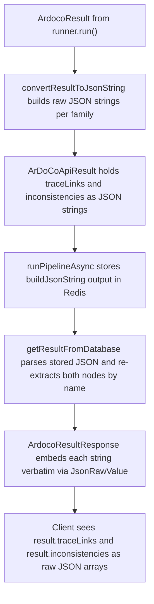

# Response and error model

The REST layer returns exactly two kinds of JSON bodies. Every successful outcome — start, start-and-wait, get-result, wait-for-result — is an `ArdocoResultResponse` envelope that either carries a result or explains why it cannot yet be delivered. Every failure that is not handled inline is converted by the `GlobalExceptionHandler` into an `ErrorResponse` body with an appropriate HTTP status. Clients therefore only need to understand these two schemas (plus Spring's inherited defaults for framework-level MVC errors such as missing request parameters).

## The success envelope: ArdocoResultResponse

`ArdocoResultResponse` (in `src/main/java/edu/kit/kastel/mcse/ardoco/tlr/rest/api/api_response/ArdocoResultResponse.java`) is the single success schema for all runner families:

| field | declared type | wire form |
| --- | --- | --- |
| `requestId` | `String` | `<keyPrefix>:<projectName><hash>`, e.g. `ardocodeResult:bigbluebutton67c34469-…` |
| `status` | `HttpStatus` | the enum **name string**, e.g. `"OK"` or `"ACCEPTED"` |
| `message` | `String` | one of the fixed `ResultMessages` constants |
| `traceLinkType` | `TraceLinkType` | the enum name, e.g. `"SAD_CODE"` |
| `result` | `ArDoCoApiResult` or `null` | raw JSON object with `traceLinks` and `inconsistencies` |

Two serialization details matter for clients and for anyone changing the schema:

- `getStatusName()` is annotated `@JsonProperty("status")` and returns `status.name()`, while the `HttpStatus`-typed `getStatus()` is `@JsonIgnore`. On the wire the status is therefore the enum name (`"OK"`), not a numeric code or a structured object.
- Both constructors derive `traceLinkType` automatically via `TraceLinkType.fromId(requestId)`, which matches the ID against the `TraceLinkType` key prefixes (`ardocodeResult`, `arcotlResult`, `swattrResult`, `transarcResult`) and falls back to `OTHER`. The response is thus self-describing: the type is recovered from the request ID, and the cross-family `/api/get-result/{id}` and `/api/wait-for-result/{id}` endpoints of `ResultController` report the correct type for any family's ID. (The InconsistencyController IDs use the derived prefix `swattrResultInconsistency` and still resolve to `SAD_SAM`.) A no-arg constructor exists for deserialization.

Every controller path constructs the response and then wraps it with `new ResponseEntity<>(response, response.getStatus())`, so the HTTP status of the response always equals the envelope's `status` field.

## The result payload: ArDoCoApiResult and @JsonRawValue

`ArDoCoApiResult` is the inner payload object. Its two fields, `traceLinks` and `inconsistencies`, are **pre-serialized JSON strings** annotated with `@JsonRawValue`:

```java
@JsonRawValue
private final String traceLinks;

@JsonRawValue
private final String inconsistencies;
```

`@JsonRawValue` makes Jackson embed the string verbatim into the response instead of quoting it, so `result.traceLinks` appears to the client as a real JSON array. This is deliberate: the trace links are converted to JSON once, right after the pipeline finishes, and are never re-serialized.

Two invariants follow from this design:

1. **The single-argument constructor guarantees an array.** `new ArDoCoApiResult(traceLinks)` sets `inconsistencies` to the literal `"[]"`, so the families that do not run inconsistency detection (`ArDoCodeService`, `ArCoTLService`, `SwattrService`, `TransArCService`) always emit `"inconsistencies": []` in the response. Only `InconsistencyService` uses the two-argument constructor with a populated array.

2. **The stored shape and the response shape must stay in sync.** The raw strings pass through three serialization points, and all three must agree:



*Lifecycle of the raw JSON payload from the pipeline result to the HTTP response.*

- `AbstractRunnerTLRService.runPipelineAsync` stores `traceLinkJson.buildJsonString()` in Redis, which composes exactly `{"traceLinks":<raw>,"inconsistencies":<raw>}`.
- `AbstractService.getResultFromDatabase` parses that stored JSON and re-extracts the `traceLinks` and `inconsistencies` nodes **by name** before rebuilding an `ArDoCoApiResult`.
- The envelope then embeds those strings via `@JsonRawValue`.

Consequently: renaming either the keys written by `buildJsonString()` or the node names read in `getResultFromDatabase` breaks retrieval; renaming the envelope properties or the `@JsonRawValue` getters changes the client-visible shape; and because the strings are embedded verbatim, anything stored under those keys must be valid JSON or the response body becomes malformed. The converters always emit at least an empty array, so both nodes are always present in stored payloads.

## Per-family payload shapes

The field names inside the raw arrays are fixed by the converters, so each family has a distinct, stable payload shape:

| family (type) | converter method | trace-link fields |
| --- | --- | --- |
| ArDoCode (`SAD_CODE`) | `convertListOfSadCodeTraceLinksToJsonString` | `sentenceNumber`, `codeElementId`, `codeElementName`; plus `modelElementId` and `modelElementName` when the link is a `TransitiveTraceLink` whose first endpoint is an `ArchitectureEntity` |
| ArCoTL (`SAM_CODE`) | `convertListOfSamCodeTraceLinksToJsonString` | `modelElementId`, `modelElementName` (`name (type)` when the type is present), `codeElementId`, `codeElementName` |
| SWATTR / Inconsistency (`SAD_SAM`) | `convertListOfSadSamTraceLinksToJsonString` | `sentenceNumber`, `modelElementName` (`name (type)` when present), `modelElementId` |
| TransArC (`SAD_SAM_CODE`) | reuses the sad-code converter | same shape as `SAD_CODE`, including the transitive-link model fields |

Inconsistency entries (from `InconsistencyConverter`) always carry `type` and `reason`, plus `sentenceNumber` for `TextEntityAbsentFromModel` or `modelElementId` for `ModelEntityAbsentFromText`. Note that `TransArCService` currently calls `result.getSadCodeTraceLinks()` and the sad-code converter, so `SAD_SAM_CODE` responses are keyed the same way as `SAD_CODE` ones — changing one converter silently changes two families' payloads.

## Status and message pairing

Message strings come only from the five `ResultMessages` constants, and the handlers pair each with a fixed status. The result field is populated exactly when the result is ready; otherwise it is `null`:

| situation | HTTP status | message | `result` |
| --- | --- | --- | --- |
| `POST …/start` — run dispatched or already in flight | 200 OK | `"The result is being processed and can be queried using the id."` (`RESULT_IS_BEING_PROCESSED`) | null |
| `POST …/start` — result already cached in Redis | 200 OK | `"The result is ready."` (`RESULT_IS_READY`) | present |
| `POST …/start-and-wait` — result ready within the wait budget | 200 OK | `RESULT_IS_READY` | present |
| `POST …/start-and-wait` — wait expired | 202 ACCEPTED | `"The request timed out before the traceLinks could be retrieved. Please try querying only the result using the projectId."` (`REQUEST_TIMED_OUT_START_AND_WAIT`) | null |
| `GET /api/get-result/{id}` — result in Redis | 200 OK | `RESULT_IS_READY` | present |
| `GET /api/get-result/{id}` — still in flight | 202 ACCEPTED | `"Result is still being processed. Please try again later."` (`RESULT_NOT_READY`) | null |
| `GET /api/get-result/{id}` — unknown or expired id | 422 | error body, `"No result with key <id> found."` | — |
| `GET /api/wait-for-result/{id}` — ready within the wait budget | 200 OK | `RESULT_IS_READY` | present |
| `GET /api/wait-for-result/{id}` — wait expired | 202 ACCEPTED | `"The request timed out before the traceLinks could be retrieved. Please try again using the projectId."` (`REQUEST_TIMED_OUT`) | null |
| `GET /api/wait-for-result/{id}` — unknown or expired id | 422 | error body, `"No result with key <id> found."` | — |

The start endpoints answer with **200, not 202**, when they dispatch a fresh run — the request itself succeeded and the ID is immediately usable. The 202 statuses are reserved for "the pipeline is running but you have nothing to consume yet". The wait budget is `tlr.timeout.seconds` (60 seconds in `application.properties`).

## Errors: ErrorResponse and GlobalExceptionHandler

`ErrorResponse` (in `api_response/ErrorResponse.java`) is the failure schema, with three fields: `timestamp` (a `ZonedDateTime` serialized with `@JsonFormat` pattern `dd-MM-yyyy HH:mm:ss z`), `status` (serialized as the enum name string), and `message`. The status-only constructor defaults the message to `"Unexpected error"`. Unlike the success envelope, the error body does not echo the request ID — the message text may embed it, as in the unknown-ID case above.

`GlobalExceptionHandler` is a `@ControllerAdvice` extending `ResponseEntityExceptionHandler`. It logs every intercepted exception and builds the `ErrorResponse` whose own status is reused as the HTTP status of the `ResponseEntity`:

| exception | HTTP status | typical trigger |
| --- | --- | --- |
| `FileNotFoundException` (the custom one in `rest.api.exception`) | 422 `UNPROCESSABLE_CONTENT` | an uploaded multipart file is empty (`FileConverter`), or the file list to hash is empty |
| `FileConversionException` | 422 | a null multipart file, a failed transfer to disk, or invalid JSON in `additionalConfigs` (`parseAdditionalConfigs`) |
| `IllegalArgumentException` | 422 | an unknown or expired result id (`getResultFromDatabase`), an unknown architecture model format string (`ModelFormatTypeConverter`) |
| `ArdocoException` | 500 `INTERNAL_SERVER_ERROR` | a pipeline failure, a stored result that is null or carries the `"Error: "` prefix, a failed JSON deserialization, or `ExecutionException`/`InterruptedException` while waiting |
| `TimeoutException` (the custom one) | 408 `REQUEST_TIMEOUT` | defensive mapping — see below |
| `Exception` (fallback) | 500 | anything not matched above |

Because the API's own `FileNotFoundException` shadows `java.io.FileNotFoundException`, the handler intercepts the API's "empty or missing uploaded file" case, not JDK file I/O. Framework-level MVC exceptions (missing request parameters, type mismatches, wrong methods) are not covered by these handlers; they fall through to the defaults inherited from `ResponseEntityExceptionHandler`. The handler methods carry swagger `@ApiResponse` annotations so that `ErrorResponse` is documented for 422, 500, and 408 in the OpenAPI UI, mirroring the `@ApiResponses` declarations of 200/202 on the controllers.

### How failures reach the client

- **Synchronous input failures** (empty file, null file, failed conversion, invalid `additionalConfigs` JSON, invalid model format) are thrown in the controller/converter layer before any pipeline starts, so the client gets an immediate 422 — this is why file handling is deliberately kept out of the asynchronous pipeline.
- **Pipeline failures** are different: `runPipelineAsync` catches the exception, stores `"Error: " + message` in Redis under the request ID, and throws `ArdocoException`. A client already blocked in `waitForResult` receives the wrapped failure as `ArdocoException` (500); a client querying later reads the error-prefixed marker, which `getResultFromDatabase` turns into the same `ArdocoException` (500). The failure therefore resurfaces as 500 until the 24h Redis TTL expires, rather than triggering a re-run.
- **Unknown or expired IDs** produce `IllegalArgumentException("No result with key <id> found.")` and thus a 422, distinct from the 202 that a still-running pipeline yields.

### The timeout nuance

The 408 mapping for the custom `TimeoutException` exists in the handler, but the custom exception is never constructed in the current code. The real waiting path is `ResultService.waitForResultHelper`, which blocks on `CompletableFuture.get(tlr.timeout.seconds, SECONDS)` and catches `java.util.concurrent.TimeoutException` — returning `Optional.empty()`, which the controllers translate into **202 Accepted** with the `REQUEST_TIMED_OUT` / `REQUEST_TIMED_OUT_START_AND_WAIT` message. So the observable behavior of an expired wait is 202, and the 408 handler remains a defensive path should a `TimeoutException` ever propagate out of a controller signature (several declare it).

## JSON examples

The success examples in `architecture_decisions.md` still match the current envelope field set, but several of their illustrative values predate the current code: the sample request IDs use retired prefixes (`SadCodeResult`, `SadSamResultInconsistency`, …) whereas the IDs now carry the `TraceLinkType` key prefixes (`ardocodeResult`, `swattrResultInconsistency`, …), and the error example shows `"UNPROCESSABLE_ENTITY"` while the current constant serializes as `"UNPROCESSABLE_CONTENT"`. The following examples use the current field names and values (hashes are illustrative):

Success (`POST /api/ardocode/start`, result already cached):

```json
{
  "requestId": "ardocodeResult:bigbluebutton67c34469-a21a-36dc-94fd-39531c9c1e6c",
  "status": "OK",
  "message": "The result is ready.",
  "traceLinkType": "SAD_CODE",
  "result": {
    "traceLinks": [
      {
        "sentenceNumber": "84",
        "codeElementId": "acm004938jsd",
        "codeElementName": "TextFileCreator"
      }
    ],
    "inconsistencies": []
  }
}
```

Success with inconsistencies (`POST /api/find-inconsistencies/start`):

```json
{
  "requestId": "swattrResultInconsistency:bigbluebutton7b258c6c-56b2-30a5-8cca-a1fb80b5547b",
  "status": "OK",
  "message": "The result is ready.",
  "traceLinkType": "SAD_SAM",
  "result": {
    "traceLinks": [
      {
        "sentenceNumber": "76",
        "modelElementName": "Redis PubSub",
        "modelElementId": "_IixQcFkJEeyewPSmlgszyA"
      }
    ],
    "inconsistencies": [
      {
        "type": "TextEntityAbsentFromModel",
        "reason": "Text indicates that \"integrations\" should be contained in the model(s) but could not be found. (confidence: 0.65)",
        "sentenceNumber": 39
      },
      {
        "type": "ModelEntityAbsentFromText",
        "reason": "Model contains an Instance \"Recording Service\" (type: \"uml:Component\")  that seems to be undocumented.",
        "modelElementId": "_kvWs4FkHEeyewPSmlgszyA"
      }
    ]
  }
}
```

Error (invalid or expired result ID):

```json
{
  "timestamp": "09-10-2024 12:58:42 CEST",
  "status": "UNPROCESSABLE_CONTENT",
  "message": "No result with key randomID123 found."
}
```

## Testing

The response model is pinned by integration tests that run against a live Redis container:

- `testUtil.TestUtils` asserts the exact status/message/result combinations of the matrix above for every flow (fresh start, cached start, not-ready get, timed-out and ready waits), so changing a message constant or a status pairing breaks the build.
- `AbstractTLRControllerTest.testRetrievingResultForInvalidId` exercises the unknown-ID path end to end and asserts `UNPROCESSABLE_CONTENT` for both retrieval endpoints; `testHandleEmptyFile` asserts the same status plus a present `timestamp` for empty uploads on both start endpoints.
- `TraceLinkConverterTest` pins that an empty trace-link list serializes to `"[]"`, which is the minimum shape the `@JsonRawValue` contract relies on.

## Related pages

- [Request IDs and result caching](request-ids-and-caching.md) — how the request ID embedded in `requestId` is built, cached, and expired.
- [Domains](../domains.md) — the runner families behind the `traceLinkType` values.
- [Testing](../testing.md) — how the controller and utility tests are organized.
- [Workflow: result retrieval](../workflows/result-retrieval.md) — the client-side polling and waiting experience that consumes these schemas.
