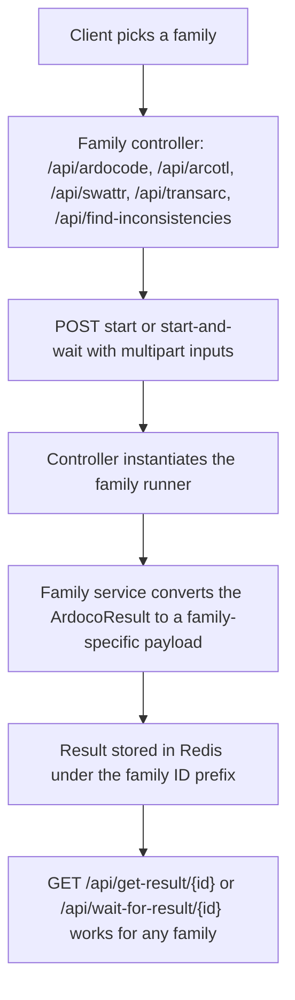

# Domains

This repository exposes several closely related trace-link recovery workflows. The business domain is ArDoCo-based recovery of trace links between software artifacts, plus one workflow that additionally detects inconsistencies between documentation and an architecture model. The current code names are authoritative; see [Naming notes](#naming-notes) for the drift between product names, trace-link labels, runner classes, and endpoint names.

## Trace-link recovery families

The controller layer shows four trace-link recovery families, each with a dedicated controller, a dedicated service, and a dedicated runner class:

| Family | Controller | Base path | `TraceLinkType` | ID prefix | Runner class | Required multipart inputs |
| --- | --- | --- | --- | --- | --- | --- |
| **ArDoCode (sad-code)** — documentation plus code | `ArDoCodeController` | `/api/ardocode` | `SAD_CODE` | `ardocodeResult` | `edu.kit.kastel.mcse.ardoco.tlr.execution.Ardocode` | `projectName`, `inputText`, `inputCode` |
| **ArCoTL (sam-code)** — architecture model plus code | `ArCoTLController` | `/api/arcotl` | `SAM_CODE` | `arcotlResult` | `edu.kit.kastel.mcse.ardoco.tlr.execution.Arcotl` | `projectName`, `inputArchitectureModel`, `inputArchitectureModelFormat`, `inputCode` |
| **SWATTR (sad-sam)** — documentation plus architecture model | `SwattrController` | `/api/swattr` | `SAD_SAM` | `swattrResult` | `edu.kit.kastel.mcse.ardoco.tlr.execution.Swattr` | `projectName`, `inputText`, `inputArchitectureModel`, `inputArchitectureModelFormat` |
| **TransArC (sad-sam-code)** — documentation, architecture model, and code | `TransArCController` | `/api/transarc` | `SAD_SAM_CODE` | `transarcResult` | `edu.kit.kastel.mcse.ardoco.tlr.execution.Transarc` | `projectName`, `inputText`, `inputArchitectureModel`, `inputArchitectureModelFormat`, `inputCode` |

Every family controller exposes the same two endpoints, both consuming `multipart/form-data`:

- `POST /api/<family>/start` — starts the pipeline and immediately returns the request ID; the result is retrieved later.
- `POST /api/<family>/start-and-wait` — starts the pipeline and blocks until the result is available (or the wait budget expires).

The ID prefix comes from the `TraceLinkType` enum (`TraceLinkType.java`), which each controller binds to its family in its constructor. The prefix both identifies the family in the Redis key and lets `TraceLinkType.fromId(id)` recover the type from any ID — which is how the cross-family result endpoints and the `traceLinkType` field of every response work (see [Request IDs and result caching](concepts/request-ids-and-caching.md) and [Response and error model](concepts/response-and-error-model.md)).

## Inconsistency detection

The `InconsistencyController` (`/api/find-inconsistencies`) adds a distinct workflow: trace-link recovery (sad-sam) combined with inconsistency detection. It uses the same multipart input style as `SwattrController` (`projectName`, `inputText`, `inputArchitectureModel`, `inputArchitectureModelFormat`, optional `additionalConfigs`), but it instantiates `edu.kit.kastel.mcse.ardoco.id.execution.runner.InconsistencyDetection` instead of a TLR runner and delegates to `InconsistencyService`.

Two properties distinguish this domain from the plain recovery families:

1. **It reuses the `SAD_SAM` trace-link type and its `swattrResult` prefix.** `InconsistencyController` overrides `generateRequestId` so its IDs are `swattrResultInconsistency:<projectName><hash>` instead of `swattrResult:<projectName><hash>`. That extra segment keeps inconsistency results keyed separately from plain SWATTR results even though both families share the same `TraceLinkType`, the same input set, and even the same `SAD_SAM` payload shape for trace links.
2. **Its response payload is richer.** `InconsistencyService` converts the sad-sam trace links *and* `result.getAllInconsistencies()` (via `InconsistencyConverter`) and returns them with the two-argument `ArDoCoApiResult` constructor — a populated `inconsistencies` array. The four recovery families use the single-argument constructor, which sets `inconsistencies` to the literal `[]`. Inconsistency entries carry `type` and `reason`, plus `sentenceNumber` for `TextEntityAbsentFromModel` and `modelElementId` for `ModelEntityAbsentFromText`.

This domain matters not just because of the different response type: it reflects a different runner setup path (`InconsistencyDetection.setUp` takes the text file, the architecture-model file, and the model format directly, rather than `ArchitectureConfiguration`/`CodeConfiguration` objects) and a different request-ID prefix.

## Result retrieval and polling

The application distinguishes between:

- starting a pipeline and immediately returning a request ID
- starting a pipeline and waiting for a result (bounded by `tlr.timeout.seconds`, 60 s; a `202 Accepted` response with a timeout message means the wait expired)
- retrieving a result later by ID
- waiting for a result later by ID

`ResultController` exposes the shared retrieval endpoints, and they are **cross-family**: `/api/get-result/{id}` and `/api/wait-for-result/{id}` serve any family's result, because IDs are self-describing — `TraceLinkType.fromId(id)` matches the ID prefix regardless of which start endpoint produced it. `ResultService` implements both operations against the two stores (in-flight futures and Redis): `getResult` returns empty while the request is in flight, and `waitForResult` blocks on the registered future rather than polling Redis. Unknown or expired IDs surface as 422 errors; a cached pipeline failure surfaces as a 500. See [Request IDs and result caching](concepts/request-ids-and-caching.md) for the dedup/TTL semantics and [Response and error model](concepts/response-and-error-model.md) for the exact status/message pairing.

## Input conventions

Across the domains, the API consistently expects:

- a `projectName` request parameter
- one or more multipart files (`inputText` and/or `inputArchitectureModel` and/or `inputCode`)
- `inputArchitectureModelFormat` — a `ModelFormat` enum value (e.g. `PCM`, `UML`) — wherever an architecture model is involved (ArCoTL, SWATTR, TransArC, and the inconsistency workflow)
- optional `additionalConfigs` JSON, parsed into a sorted map and passed to the runner; invalid JSON raises `FileConversionException`

`ModelFormatTypeConverter` (a Spring `Converter<String, ModelFormat>`) binds the format parameter directly to the `ModelFormat` enum; an unknown format name surfaces as an `IllegalArgumentException`. Code uploads are always interpreted as `CodeConfiguration.CodeConfigurationType.ACM_FILE`. The REST layer only validates that uploaded files are non-empty; the deeper format checks are left to the ArDoCo tooling itself.

Each family's controller converts the multipart uploads to temporary files, generates the request ID from the file contents, and then instantiates and configures the runner with a throwaway output directory (`Files.createTempDirectory("ardoco-<family>")`): `ardoco-sad-code`, `ardoco-sam-code`, `ardoco-sad-sam`, `ardoco-sad-sam-code`, and `ardoco-id` for the inconsistency workflow. Runner setup happening in the controller — before the service decides whether the run is even needed — is a documented trade-off; see [Architecture](architecture.md#runner-setup-happens-in-the-controllers-documented-trade-off).

*Every family follows the same controller-to-service-to-Redis flow; only the runner, the input set, and the payload shape differ.*

## Per-family payload shapes

Each family's service converts the runner output through `TraceLinkConverter` into the JSON payload stored in Redis and returned to clients:

| Family | Service | Converter method | Trace-link fields |
| --- | --- | --- | --- |
| ArDoCode (`SAD_CODE`) | `ArDoCodeService` | `convertListOfSadCodeTraceLinksToJsonString` | `sentenceNumber`, `codeElementId`, `codeElementName`; plus `modelElementId` and `modelElementName` on transitive links |
| ArCoTL (`SAM_CODE`) | `ArCoTLService` | `convertListOfSamCodeTraceLinksToJsonString` | `modelElementId`, `modelElementName`, `codeElementId`, `codeElementName` |
| SWATTR (`SAD_SAM`) | `SwattrService` | `convertListOfSadSamTraceLinksToJsonString` | `sentenceNumber`, `modelElementName`, `modelElementId` |
| Inconsistency (`SAD_SAM`) | `InconsistencyService` | `convertListOfSadSamTraceLinksToJsonString` + `InconsistencyConverter` | SWATTR trace-link shape plus a populated `inconsistencies` array |
| TransArC (`SAD_SAM_CODE`) | `TransArCService` | reuses the sad-code converter | same shape as `SAD_CODE` |

`TransArCService` currently calls `result.getSadCodeTraceLinks()` and the sad-code converter, so `SAD_SAM_CODE` responses are keyed the same way as `SAD_CODE` ones — changing one converter silently changes two families' payloads. Inconsistency entries always carry `type` and `reason`. Full field semantics live in [Response and error model](concepts/response-and-error-model.md#per-family-payload-shapes).

## Naming notes

The repository contains multiple naming conventions that are useful to keep straight:

- **product names**: ArDoCo, ArDoCode, ArCoTL, SWATTR, TransArC
- **trace-link labels**: `SAD_CODE`, `SAM_CODE`, `SAD_SAM`, `SAD_SAM_CODE` (the `TraceLinkType` enum names)
- **ID prefixes**: `ardocodeResult`, `arcotlResult`, `swattrResult`, `transarcResult`, plus the derived `swattrResultInconsistency` for the inconsistency workflow
- **endpoint names** in the enum: `ardocode`, `arcotl`, `swattr`, `transarc`, `other` — these are what the controller tests use to build `/api/<endpointName>/start`
- **runner classes**: `Ardocode`, `Arcotl`, `Swattr`, `Transarc`, `InconsistencyDetection`
- **service bean names**: `sadCodeTLRService`, `ArCoTLService`, `swattrService`, `transArCService`, `InconsistencyService`

The drift is visible in several places: the TransArC runner class is `Transarc` while its controller and service are `TransArCController`/`TransArCService`; the ArDoCode runner is `Ardocode`; test class names (`ArDoCoForSadCodeControllerTest`, `ArDoCoForSadSamTLRControllerTest`, `ArDoCoForSadSamCodeControllerTest`) use different names than their controllers; and some Swagger annotations still say "ardoco-pipeline" or "Arcotl". When adding a family, prefer the current controller/service names in code and keep the `TraceLinkType` binding, ID prefix, and endpoint path consistent — the docs and source both show naming drift over time, so user-facing docs should be updated carefully.

## How to extend

Adding a new family means: a new `TraceLinkType` entry (label + ID prefix + endpoint name), a new controller extending `AbstractController` with `/start` and `/start-and-wait` handlers, a new `AbstractRunnerTLRService` subclass implementing `convertResultToJsonString`, and a controller test subclassing `AbstractTLRControllerTest` (which derives the endpoint paths from the `TraceLinkType` endpoint name). The shared `AbstractController`/`AbstractRunnerTLRService` machinery — dedup, async execution, Redis storage, ID generation, and the cross-family retrieval endpoints — requires no changes.

## Related pages

- [Architecture](architecture.md) — layering, the request lifecycle, and the runner-setup trade-off
- [Request IDs and result caching](concepts/request-ids-and-caching.md) — how family IDs are constructed and why they enable caching
- [Response and error model](concepts/response-and-error-model.md) — the envelope, the per-family payload shapes, and the status/message pairing
- [Testing](testing.md) — the per-family controller tests and what to run after changes

## Source references

- `src/main/java/edu/kit/kastel/mcse/ardoco/tlr/rest/api/api_response/TraceLinkType.java`
- `src/main/java/edu/kit/kastel/mcse/ardoco/tlr/rest/api/controller/ArDoCodeController.java`
- `src/main/java/edu/kit/kastel/mcse/ardoco/tlr/rest/api/controller/ArCoTLController.java`
- `src/main/java/edu/kit/kastel/mcse/ardoco/tlr/rest/api/controller/SwattrController.java`
- `src/main/java/edu/kit/kastel/mcse/ardoco/tlr/rest/api/controller/TransArCController.java`
- `src/main/java/edu/kit/kastel/mcse/ardoco/tlr/rest/api/controller/InconsistencyController.java`
- `src/main/java/edu/kit/kastel/mcse/ardoco/tlr/rest/api/controller/ResultController.java`
- `src/main/java/edu/kit/kastel/mcse/ardoco/tlr/rest/api/service/ArDoCodeService.java`
- `src/main/java/edu/kit/kastel/mcse/ardoco/tlr/rest/api/service/ArCoTLService.java`
- `src/main/java/edu/kit/kastel/mcse/ardoco/tlr/rest/api/service/SwattrService.java`
- `src/main/java/edu/kit/kastel/mcse/ardoco/tlr/rest/api/service/TransArCService.java`
- `src/main/java/edu/kit/kastel/mcse/ardoco/tlr/rest/api/service/InconsistencyService.java`
- `src/main/java/edu/kit/kastel/mcse/ardoco/tlr/rest/api/service/ResultService.java`
- `src/main/java/edu/kit/kastel/mcse/ardoco/tlr/rest/api/converter/TraceLinkConverter.java`
- `src/main/java/edu/kit/kastel/mcse/ardoco/tlr/rest/api/converter/InconsistencyConverter.java`
- `src/main/java/edu/kit/kastel/mcse/ardoco/tlr/rest/api/converter/ModelFormatTypeConverter.java`
