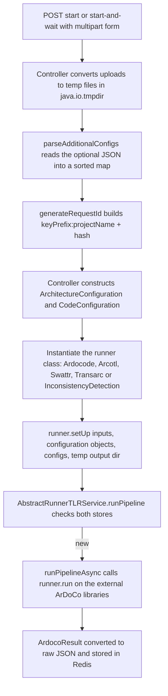

# ArDoCo runner integration

ArDoCo REST does not implement trace-link recovery itself. It is a thin HTTP layer around the external ArDoCo libraries: the REST layer only shapes the request (multipart handling, request-ID generation, runner setup) and then delegates the actual analysis to a runner class from the ArDoCo project. This page documents how the REST layer binds to those libraries — which runner classes exist, how each runner's `setUp` signature maps to the endpoint's multipart inputs, how the `inputArchitectureModelFormat` parameter is converted to ArDoCo's `ModelFormat`, why the runner's output directory is a throwaway temp directory, and how `/api/configuration` exposes ArDoCo's default configuration keys for clients to reuse as `additionalConfigs`.

## The ArDoCo libraries as Maven dependencies

The REST layer pulls in the external ArDoCo libraries as Maven dependencies (`pom.xml`):

| Artifact | Purpose |
| --- | --- |
| `io.github.ardoco.core:common` | Core ArDoCo types used by the REST layer (`ArdocoRunner`, `ArdocoResult`, `ModelFormat`, configuration utilities) |
| `io.github.ardoco.id:pipeline-id` | The inconsistency-detection pipeline (the `InconsistencyDetection` runner) |
| `io.github.ardoco.tlr:pipeline-tlr` | The trace-link recovery pipelines (the `Ardocode`, `Arcotl`, `Swattr`, `Transarc` runners) |
| `io.github.ardoco.tlr:text-preprocessing` | Text preprocessing support used by the TLR pipelines |

All four are resolved at the ArDoCo snapshot version `${ardoco.version}` from the Sonatype snapshot repository, so the REST layer tracks the ArDoCo codebase it sits on top of. This is the boundary in the other direction too: the REST layer does not import any ArDoCo *stage* implementations — every analysis happens inside `runner.run()` on the external libraries.

## Runner classes and their setup signatures

Each runner family has a dedicated controller that instantiates and configures the external ArDoCo runner class itself, in the controller layer (a documented trade-off — see [Architecture](../architecture.md)). The runner classes come from `edu.kit.kastel.mcse.ardoco.tlr.execution` (TLR runners) and `edu.kit.kastel.mcse.ardoco.id.execution.runner` (inconsistency detection), all extending `ArdocoRunner`:

| Controller | Base path | Runner class | `setUp` signature (in order) |
| --- | --- | --- | --- |
| `ArDoCodeController` | `/api/ardocode` | `edu.kit.kastel.mcse.ardoco.tlr.execution.Ardocode` | text file, `CodeConfiguration`, configs, output dir |
| `ArCoTLController` | `/api/arcotl` | `edu.kit.kastel.mcse.ardoco.tlr.execution.Arcotl` | `ArchitectureConfiguration`, `CodeConfiguration`, configs, output dir |
| `SwattrController` | `/api/swattr` | `edu.kit.kastel.mcse.ardoco.tlr.execution.Swattr` | text file, `ArchitectureConfiguration`, configs, output dir |
| `TransArCController` | `/api/transarc` | `edu.kit.kastel.mcse.ardoco.tlr.execution.Transarc` | text file, `ArchitectureConfiguration`, `CodeConfiguration`, configs, output dir |
| `InconsistencyController` | `/api/find-inconsistencies` | `edu.kit.kastel.mcse.ardoco.id.execution.runner.InconsistencyDetection` | text file, architecture file, `ModelFormat`, configs, output dir |

Two observations follow from these signatures:

1. **The TLR runners take `ArchitectureConfiguration`/`CodeConfiguration` objects; the ID runner does not.** `InconsistencyDetection.setUp` takes the text and architecture files directly plus the `ModelFormat` — no configuration objects — because the ID pipeline only needs the architecture model, not a separate code model.
2. **The TLR runners always use `CodeConfiguration.CodeConfigurationType.ACM_FILE`.** Every runner that accepts code takes the uploaded `.acm` file as `new CodeConfiguration(inputFileMap.get(CODE_PARAMETER), CodeConfiguration.CodeConfigurationType.ACM_FILE)`. The REST layer has no other code-input mode; a different code source would require a new `CodeConfigurationType` and a new endpoint parameter.

The `ArchitectureConfiguration` constructor takes the architecture-model file and the `ModelFormat` enum value — which is where the `inputArchitectureModelFormat` request parameter ends up (see [ModelFormat conversion](#modelformat-conversion)).



*How a request is bound to the external ArDoCo runner, from multipart input to the asynchronous `runner.run()` call.*

## ModelFormat conversion

The `inputArchitectureModelFormat` request parameter is bound to the `ModelFormat` enum from `edu.kit.kastel.mcse.ardoco.core.api.models`, which is part of the external ArDoCo libraries. This is done by `ModelFormatTypeConverter`:

```java
@Component
public class ModelFormatTypeConverter implements Converter<String, ModelFormat> {
    @Override
    public ModelFormat convert(String source) {
        try {
            return ModelFormat.valueOf(source);
        } catch (IllegalArgumentException e) {
            throw new IllegalArgumentException("Invalid architecture model type: " + source, e);
        }
    }
}
```

`WebConfig` registers the converter as a Spring MVC converter, so the `inputArchitectureModelFormat` request parameter binds directly to the `ModelFormat` enum value. An unknown format name surfaces as `IllegalArgumentException("Invalid architecture model type: ...")`, which the `GlobalExceptionHandler` maps to a 422 error body. The set of valid values is defined by the ArDoCo libraries themselves — the REST layer does not maintain its own list, so a new ArDoCo model format becomes available automatically without a REST-layer change.

The REST layer does not perform any file-type validation beyond the empty-file check in `FileConverter`. Whether the uploaded file is a valid PCM, UML, or OpenAM model is checked by ArDoCo itself when the runner runs the pipeline. This is a documented decision ("So far no file checks have been implemented. This is left to ArDoCo itself"), so the REST layer only rejects empty files (422) and lets ArDoCo surface format errors as pipeline failures (500).

## Throwaway temp output directories

Every runner's `setUp` call includes a `File` argument that is the runner's **output directory**. The REST layer never exposes this directory — it is a throwaway temp directory created per request:

```java
Files.createTempDirectory("ardoco-sad-code").toFile()
```

The prefix differs per family: `ardoco-sad-code` (ArDoCode), `ardoco-sam-code` (ArCoTL), `ardoco-sad-sam` (SWATTR), `ardoco-sad-sam-code` (TransArC), `ardoco-id` (InconsistencyDetection). The temp directory exists only because the ArDoCo runners require an output directory — the REST layer never reads from it, because results are returned via the API rather than as output files. This is a documented design decision ("The output directory, which is required by ardoco when running any pipeline, is internally set to a temporary directory and is not made available to the outside, since the result will be returned in form of a response entity").

The input files are also temporary: `FileConverter.convertMultipartFileToFile` writes each uploaded multipart file to `System.getProperty("java.io.tmpdir")`, and the `finally` block in `AbstractRunnerTLRService.runPipelineAsync` deletes all of them after the pipeline finishes (or fails). The temp output directory is left to the JVM's own temp-file cleanup, since it never contains anything the client needs.

## Passing additionalConfigs to the runner

The optional `additionalConfigs` request parameter is a JSON string that `AbstractController.parseAdditionalConfigs` parses into a `TreeMap<String, String>`; invalid JSON raises `FileConversionException` (422). Each controller then wraps it with `SortedMaps.immutable.withSortedMap(...)` into an `ImmutableSortedMap<String, String>` and passes it directly to the runner's `setUp` — the ArDoCo libraries themselves interpret the configuration keys, so the REST layer has no schema for them. The config keys and values a client can use are exactly what `/api/configuration` returns (see [The /api/configuration endpoint](#the-apiconfiguration-endpoint)); a client can fetch that map and feed any subset of it back as `additionalConfigs`.

Note that `additionalConfigs` is deliberately not part of the request-ID hash — two requests that differ only in configuration collide on the same ID and reuse the cached result (see [Request IDs and result caching](../concepts/request-ids-and-caching.md)).

## The /api/configuration endpoint

`ConfigurationProviderController` exposes `GET /api/configuration`, which returns ArDoCo's default configuration as a `Map<String, String>` of config keys and their default values. The map is produced entirely by reflection in `ConfigurationProviderService`:

1. **Scan** — `new Reflections(ARDOCO)` scans the whole `edu.kit.kastel.mcse.ardoco` package space (the REST layer's own package included) and collects `getSubTypesOf(AbstractConfigurable.class)`.
2. **Filter** — keep only non-abstract classes whose package still starts with `edu.kit.kastel.mcse.ardoco` and whose package does not contain `tests`.
3. **Instantiate** — `ConfigurationInstantiatorUtils.createObject(clazz)` creates a default instance of each class.
4. **Collect** — `findImportantFields` walks the class hierarchy (`Object.class` and `AbstractConfigurable.class` excluded) and collects every field annotated `@Configurable`. For each field, the key comes from `AbstractConfigurable.getKeyOfField(object, f.getDeclaringClass(), f)`, and the default value comes from the freshly instantiated object's field.
5. **Convert** — `getValue` turns the raw field value into a `String`: `Integer` → decimal, `Double` → `Locale.ENGLISH`-formatted, `Boolean` → `true`/`false`, `List<String>` → joined with `AbstractConfigurable.LIST_SEPARATOR`, `Enum` → `name()`. Any other value type throws `IllegalArgumentException("RawValue has no type that may be transformed to an Configuration...")`.
6. **Assemble** — results are accumulated in a `TreeMap`, so the response is a sorted map. A duplicate key logs a warning and overwrites the earlier entry (last wins).

The endpoint is a *discovery* mechanism: the returned map is exactly the set of `additionalConfigs` keys the ArDoCo libraries accept, so a client can fetch it and feed any subset of it back as `additionalConfigs` on a pipeline-start request. Because the scan is reflection-based, the endpoint automatically tracks new ArDoCo versions — any new `AbstractConfigurable` subclass with `@Configurable` fields appears in the response without a REST-layer change. The cost is that the scan is expensive: it instantiates every configurable class in the ArDoCo codebase on every request, so the endpoint is not a high-frequency polling target.

The result-conversion side of the integration — how the `ArdocoResult` produced by `runner.run()` is turned into the per-family JSON payload — is covered in [Architecture](../architecture.md) and [Response and error model](../concepts/response-and-error-model.md). In brief: each runner family has its own concrete `AbstractRunnerTLRService` subclass whose `convertResultToJsonString` converts the runner-specific trace links (and, for inconsistency detection, also the inconsistencies) via `TraceLinkConverter`/`InconsistencyConverter`, then stores the raw JSON in Redis under the request ID.

## Testing

The runner integration is pinned by integration tests that run against a live Redis container (`redis:7.0-alpine` via Testcontainers):

- `AbstractTLRControllerTest` and its four subclasses exercise the full start → poll → retrieve flow for every family, including the `start-and-wait` endpoints and the empty-file rejection path. The tests use real project artifacts (`bigBlueButton/bigbluebutton.txt`, `codeModel.acm`, `bbb.repository` for PCM, `bbb.uml` for UML) — so they exercise the actual `ModelFormat` binding and the actual ArDoCo runner setup, not mocked runners.
- `ArDoCoForSadSamCodeControllerTest` and `ArDoCoForSadSamTLRControllerTest` both run against `ModelFormat.UML` *and* `ModelFormat.PCM`, pinning the `ArchitectureConfiguration` + `ModelFormat` binding from both formats.
- `ArDoCoForSadCodeControllerTest` covers the sad-code runner, whose `setUp` only takes text + code (no `ArchitectureConfiguration`).
- `HashGeneratorTest`, `FileConverterTest`, and `TraceLinkConverterTest` pin the file-to-hash, multipart-to-file, and trace-link-to-JSON conversions that sit between the HTTP layer and the runner.

Because the runner classes are external libraries at snapshot versions, the integration tests double as the compatibility check: a new ArDoCo version that changes a runner's `setUp` signature or converter behavior breaks the controller tests.

## Related pages

- [Architecture](../architecture.md) — the controller/service/repository layering and the request lifecycle that wraps the runner setup.
- [Domains](../domains.md) — the five runner families and their endpoint paths, trace-link types, and required multipart inputs.
- [Request IDs and result caching](../concepts/request-ids-and-caching.md) — how the request ID is built and why `additionalConfigs` is not hashed.
- [Response and error model](../concepts/response-and-error-model.md) — the success envelope and the per-family payload shapes the runners produce.
- [Workflow: pipeline execution](../workflows/pipeline-execution.md) — the end-to-end start → poll → retrieve flow.
- [Testing](../testing.md) — the test tree, including the controller integration tests.
- [Redis persistence integration](redis.md) — how the runner results are persisted.
