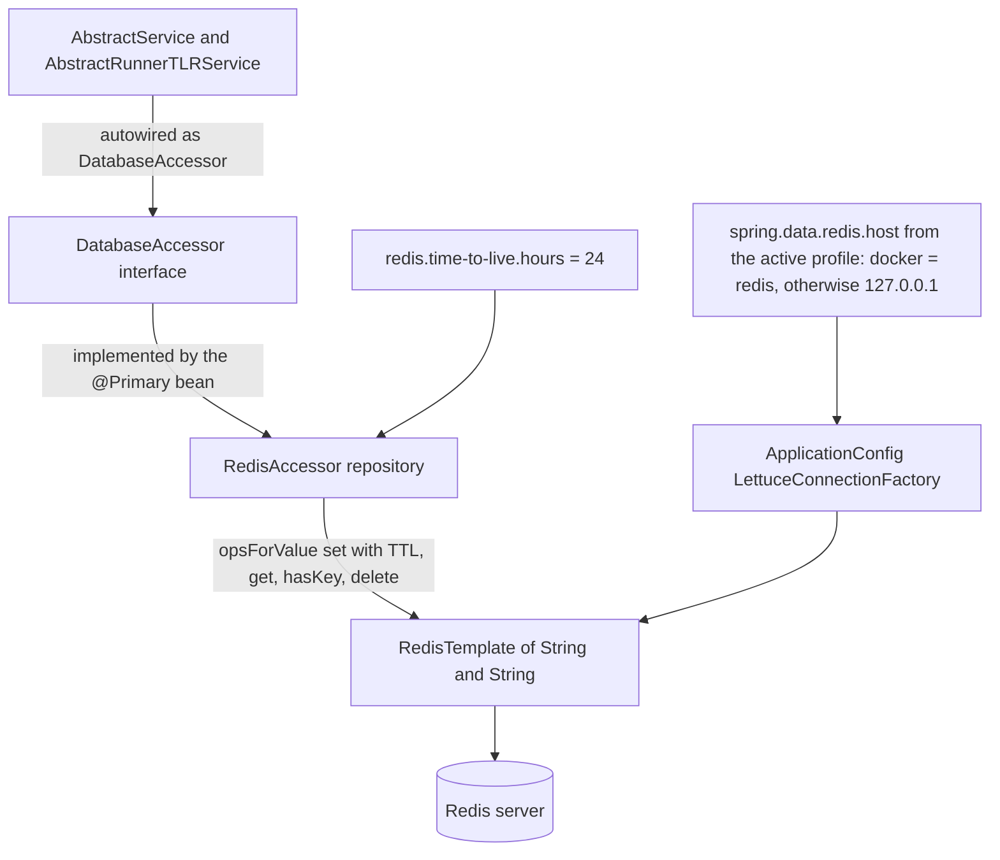

# Redis persistence integration

ArDoCo REST has no relational store. Its only persistence layer is a Redis-backed, flat key-value cache of pipeline results: each finished run stores one plain-string value (a raw JSON payload or an error message) under the content-based request ID, with a time-to-live of 24 hours. This page documents the persistence boundary (`DatabaseAccessor`), its `@Primary` Redis implementation (`RedisAccessor`), the connection setup in `ApplicationConfig`, the Spring profile split that selects the Redis host per deployment topology, and the local Docker Compose / RedisInsight tooling. How request IDs become Redis keys is covered in [Request IDs and result caching](../concepts/request-ids-and-caching.md).

## The persistence boundary: DatabaseAccessor

`DatabaseAccessor` (`src/main/java/edu/kit/kastel/mcse/ardoco/tlr/rest/api/repository/DatabaseAccessor.java`) is the interface through which the whole application touches the database. It has four methods, all keyed by the string request ID:

- `saveResult(String id, String jsonResult)` — stores a value and returns the id for confirmation.
- `getResult(String id)` — returns the stored value, or `null` when no result exists.
- `keyExistsInDatabase(String key)` — existence check.
- `deleteResult(String id)` — removal; returns `false` when the key does not exist.

Its Javadoc states the intent explicitly: "allowing for easy database switching". Both service-layer base classes depend only on the interface — `AbstractService` autowires a private `DatabaseAccessor`, and `AbstractRunnerTLRService` a protected one — so services never see Redis types. `RedisAccessor` is annotated `@Primary`, which makes it the implementation Spring injects everywhere; a different backing store can be swapped in by providing another `DatabaseAccessor` implementation without touching service code.

*The persistence boundary: services depend on the `DatabaseAccessor` interface; the `@Primary` `RedisAccessor` implements it over a profile-configured Lettuce `RedisTemplate`, writing plain-string values with a TTL.*

## RedisAccessor: TTL-bound plain-string storage

`RedisAccessor` (`@Primary @Repository`) injects a `RedisTemplate<String, String>` and reads its expiry from `@Value("${redis.time-to-live.hours}")` — `24` in `application.properties`. Every write goes through `template.opsForValue().set(id, jsonResult, timeToLive, TimeUnit.HOURS)`, so **every stored result has an expiry**: after 24 hours the request ID becomes stale, and a repeated request re-runs the pipeline instead of serving the cache. The read helpers are correspondingly thin: `getResult` is a plain `opsForValue().get`, `keyExistsInDatabase` is `Boolean.TRUE.equals(template.hasKey(key))` (null-safe), and `deleteResult` is `template.delete(id)`.

Two properties of the value format matter:

1. **Values are plain strings, not structured Redis objects.** A successful run stores the raw JSON payload built by `ArDoCoApiResult.buildJsonString()` (`{"traceLinks":...,"inconsistencies":...}`); `AbstractService.getResultFromDatabase` later parses the `traceLinks` and `inconsistencies` fields out of that string with Jackson.
2. **Failed runs cache their error message like a result.** `AbstractRunnerTLRService.runPipelineAsync` catches any pipeline failure and stores `"Error: " + message` under the ID with the same 24h TTL. On the read side, `getResultFromDatabase` throws an `ArdocoException` when the value is `null` or starts with the `Error: ` prefix — so within the TTL window, a cached failure surfaces as an exception rather than triggering a re-run. (When the key is absent entirely, `getResultFromDatabase` throws `IllegalArgumentException` with "No result with key %s found." before reading.)

The details of this read path and its consequences for API clients are documented in [Request IDs and result caching](../concepts/request-ids-and-caching.md).

## @EnableRedisRepositories without Redis repositories

`ApplicationConfig` carries `@EnableRedisRepositories`, but the codebase defines no Redis entities (`@RedisHash`) and no repository interfaces extending Spring Data's repository contracts. Persistence is done entirely through `RedisTemplate` string operations. The only `@Repository` beans in the app are `RedisAccessor` (the Redis-backed one) and `CurrentlyRunningRequestsRepository`, which is *not* Redis-backed at all — it is a singleton `ConcurrentHashMap` of `CompletableFuture<ArDoCoApiResult>` used to track in-flight pipeline runs. A reader should therefore not expect Spring Data Redis repository semantics (secondary indexes, expiry sets, etc.) anywhere in this application.

## Connection setup in ApplicationConfig

`ApplicationConfig` (`src/main/java/edu/kit/kastel/mcse/ardoco/tlr/rest/ApplicationConfig.java`, annotated `@Configuration`, `@EnableAutoConfiguration`, `@EnableRedisRepositories`) owns the connection:

- It reads `spring.data.redis.host` and `spring.data.redis.port` via `@Value`.
- It defines a `LettuceConnectionFactory` bean built from an explicit `RedisStandaloneConfiguration` seeded with those values. The in-code comment warns that this is deliberate: "! You have to provide the redisStandaloneConfiguration or else the app wont work with docker" — the explicit configuration is what makes the profile-driven host take effect instead of a factory defaulting to localhost.
- It defines a `redisTemplate` bean wired to that factory; this is the template instance `RedisAccessor` injects as `RedisTemplate<String, String>`.

The template is created without any serializer configuration, so Spring Data Redis' defaults apply: keys and values are JDK-serialized strings. In RedisInsight this shows up as keys with a binary serialization prefix rather than the plain request-ID text. For completeness: `pom.xml` declares `spring-boot-starter-data-redis` (whose default client is Lettuce) and additionally `redis.clients:jedis:8.0.2`, but no source code references Jedis — the connection path is entirely Lettuce.

## The Spring profile split

Only one property actually differs between environments — the Redis host — and it is switched via Spring profiles:

| Profile | File | `spring.data.redis.host` |
| --- | --- | --- |
| default | `application.properties` | `127.0.0.1` |
| `local` | `application-local.properties` | `127.0.0.1` |
| `docker` | `application-docker.properties` | `redis` |

The port (`6379`), the empty `spring.data.redis.username`/`password`, and the TTL (`redis.time-to-live.hours=24`) all live in the base `application.properties` and are not overridden by any profile. A comment in that file records the rule: "when the application runs inside docker redis.host neds to be redis".

The containerized runtime activates the docker profile itself — the `Dockerfile` sets `ENV SPRING_PROFILES_ACTIVE=docker` — so the app inside a container resolves Redis through the compose service hostname `redis` on the shared Docker network, while a host-run application uses the default or `local` profile against `127.0.0.1`. CI sets the same profile: `.github/workflows/ci.yml` runs `mvn verify` with `SPRING_PROFILES_ACTIVE=docker` next to a `redis` service container published on port 6379. In the test JVMs the actual connection is nevertheless bound by the Testcontainers host/port overrides described below, which take precedence over the profile property file.

## Docker Compose topology and local tooling

`docker-compose-template.yaml` defines three services on a bridge network named `app-network`:

- **`redis`** — image `redis`, container name `redis`, `restart: always`, data volume `./data:/data`, and the command `redis-server --bind 0.0.0.0 --port 6379`. Port 6379 is declared with `expose`, not `ports`: **Redis is deliberately not published to the host**, only reachable from containers on `app-network` — which is exactly what the docker profile's `redis` hostname assumes.
- **`redisinsight`** — image `redis/redisinsight`, published at `127.0.0.1:5540:5540`, `depends_on` redis, data volume `./redisinsight:/data`. This is the GUI for inspecting the stored results.
- **`app`** — the Spring Boot image built from the repository `Dockerfile` (`ghcr.io/ardoco/rest`), published at `127.0.0.1:8080:8080`, `depends_on` redis.

The mounted directories are local working volumes: `.gitignore` excludes their contents (`data/*`, `redisinsight/*`), and it also excludes the instantiated `docker-compose.yml` — the template is meant to be copied and adapted locally.

The README's run flow: add credentials to `redis/redis_template.env`, rename it to `redis/redis.env`, run `docker-compose up -d`, start the application, and browse the database at `http://localhost:5540`. `HELP.md` additionally documents `docker exec -it redis redis-cli` with an optional `AUTH <password>`. Two caveats about credentials and reachability as shipped:

- **Redis runs unauthenticated by default.** The compose template does not wire `redis.env` into the redis service, and `spring.data.redis.username`/`password` are empty in `application.properties` (the `spring.config.import=optional:file:.env[.properties]` line that would import an env file is commented out). The template env file (`REDIS_PASSWORD`, `REDIS_USERNAME`, `REDIS_HOST`, `REDIS_PORT`) documents the intended credential flow, but enabling it requires local adaptation.
- **A host-run app cannot reach the containerized Redis with the unmodified template.** Because 6379 is only `expose`d, an application using the default/`local` profile (`127.0.0.1:6379`) needs either a published host port in its local `docker-compose.yml` or a Redis running directly on the host. The full-docker topology (app container + docker profile) needs no change.

## Health and operations notes

- The application-level `/api/health` endpoint returns a static `"OK"` and does not verify the Redis connection. Redis reachability is instead observable through the actuator health endpoint (`/actuator/health`), which `application.properties` exposes with `management.endpoint.health.show-details=always`.
- `logging.level.org.springframework.data.redis=DEBUG` is on by default, so Redis client activity is visible in the application logs.

## Testing

- `RedisAccessorTest` (`src/test/java/edu/kit/kastel/mcse/ardoco/tlr/rest/api/repository/RedisAccessorTest.java`) is a `@SpringBootTest` that starts a real Redis via Testcontainers (`redis:7.0-alpine` `GenericContainer`) and overrides `spring.data.redis.host`/`port` dynamically (both through `System.setProperty` and `@DynamicPropertySource`). It verifies the accessor semantics: save-then-get round-trips with the id echoed back, `keyExistsInDatabase` turning true, overwriting an existing key, `null`/`false` for unknown keys, and that a `null` key raises `IllegalArgumentException` from the template.
- The controller integration tests (`AbstractTLRControllerTest` and its per-family subclasses) bind against the real persistence: they inject `RedisAccessor`, assert `keyExistsInDatabase` at each stage of the start → poll → retrieve flow, and call `deleteResult` as cleanup. Their Redis containers are wired the same way (Testcontainers container plus `System.setProperty` host/port overrides).
- `RedisConnectionTest` and `RedisRealConnectionTest` exist but their bodies are entirely commented out — they are empty shells, not active coverage.

For the CI setup (docker profile plus a `redis` service container) and broader test organization, see [Testing](../testing.md); operational run notes live in [Operations](../operations.md).

## Related pages

- [Request IDs and result caching](../concepts/request-ids-and-caching.md) — how request IDs become Redis keys, dedup behavior, and TTL consequences for clients.
- [Workflow: pipeline execution](../workflows/pipeline-execution.md) — where `saveResult` and the error-string path sit in the run lifecycle.
- [ArDoCo runner integration](ardoco-runners.md) — how the results that end up in Redis are produced.
- [Operations](../operations.md) — local setup, endpoints, and infrastructure.
- [Testing](../testing.md) — what to run after changing persistence-related code.
