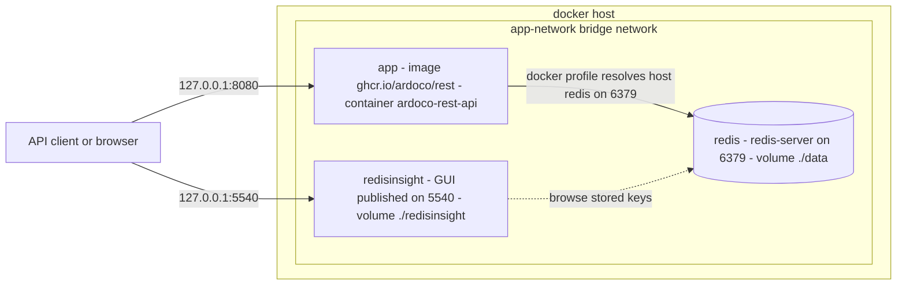
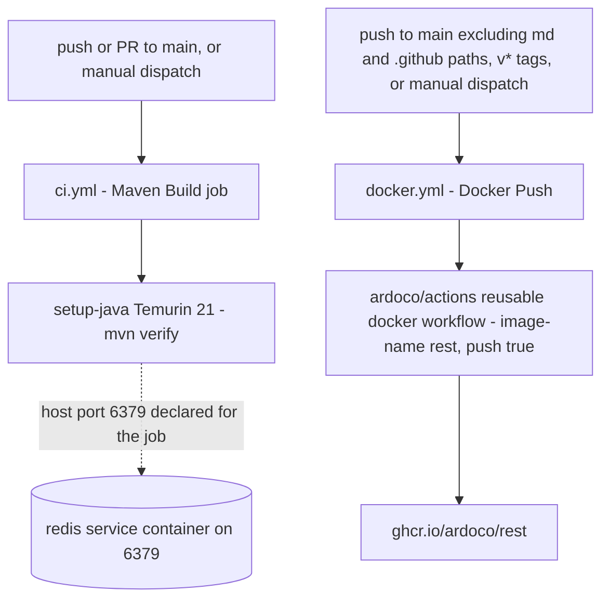

# Operations

ArDoCo REST is a Spring Boot web service built with Maven against the shared `io.github.ardoco:parent` POM. It listens on port 8080, keeps all durable state in Redis on port 6379, and ships with a Docker Compose template (redis, redisinsight, app), a multi-stage Dockerfile, and GitHub Actions workflows for CI and container publishing. This page covers the build, the local run flow, the container topology, the observable endpoints, and the repository automation. The request lifecycle behind those endpoints is described in [Architecture](architecture.md), and the persistence layer in [Redis persistence integration](integrations/redis.md).

## Build with Maven

The artifact is `io.github.ardoco:rest:2.1.0-SNAPSHOT` (name `ArDoCo-REST`). The parent is `io.github.ardoco:parent:2.1.0`, and a Maven wrapper (`mvnw`, `mvnw.cmd`) is checked in. The build commands used in practice:

- `mvn verify` — the CI command; runs unit and integration tests (the Maven Failsafe plugin is bound to `integration-test` and `verify` in the `integration-test` phase).
- `mvn -DskipTests clean package` — the command the Docker build stage runs.
- `spring-boot-maven-plugin` repackages the artifact with main class `edu.kit.kastel.mcse.ardoco.tlr.rest.ArDoCoRestApplication`, producing `target/rest-*.jar` — the exact file the Dockerfile's runtime stage copies.

Other build wiring: Spotless formatting (repo-root config in `formatter.xml`, `spotless.importorder`, `license-header`), and `maven-compiler-plugin` with `<parameters>true</parameters>` to retain parameter names for Spring Framework 6 parameter-name discovery.

### Dependency management quirks

Three quirks matter when changing dependencies:

1. **Spring Boot BOM import.** `pom.xml` does not use Spring Boot as its parent; instead it imports `org.springframework.boot:spring-boot-dependencies:4.1.1` into `dependencyManagement` with `scope=import`, on top of the ArDoCo parent POM.
2. **JUnit version override.** `<junit.version>` is pinned to `6.0.3` with the stated intent of overriding the JUnit version inherited from the parent POM by the Spring Boot-managed one. For the override to take effect, `pom.xml` additionally declares explicit `junit-jupiter-api`, `junit-jupiter-engine`, and `junit-jupiter-params` dependencies pinned to `${junit.version}`, while the `junit-jupiter` aggregate stays unversioned so the BOM manages it. Dependabot's config confirms the alignment is deliberate and manual: it ignores `org.junit.jupiter:*` with the comment "JUnit is aligned manually with the version managed by Spring Boot (junit.version in pom.xml)". (The inline comment still names "Spring Boot 4.0.6" although the imported BOM is 4.1.1.)
3. **`ardoco.version` snapshot property.** The four ArDoCo libraries (`common`, `pipeline-id`, `pipeline-tlr`, `text-preprocessing`) use the inherited `${ardoco.version}` property from the parent POM, which tracks ArDoCo snapshot builds. The pom therefore enables the Sonatype snapshot repository (`https://central.sonatype.com/repository/maven-snapshots/`, snapshots enabled, releases disabled) next to Maven Central. The REST layer's dependency on these runners is covered in [ArDoCo runner integration](integrations/ardoco-runners.md).

Note the Java version split: verification (CI) runs on Temurin **Java 21**, while the container image builds and runs on **Java 25** (`maven:3-eclipse-temurin-25-alpine` build stage, `eclipse-temurin:25-jre-alpine` runtime).

## Runtime configuration and Spring profiles

`src/main/resources/application.properties` holds the operational knobs:

| Setting | Value | Meaning |
| --- | --- | --- |
| `spring.data.redis.host` / `.port` | `127.0.0.1` / `6379` | Redis address used by the default profile |
| `spring.data.redis.username` / `.password` | empty | No Redis credentials by default |
| `redis.time-to-live.hours` | `24` | TTL applied to every stored result |
| `tlr.timeout.seconds` | `60` | How long `/api/wait-for-result` and `start-and-wait` block |
| `spring.servlet.multipart.max-file-size` | `200MB` | Upload limit for model/text/code files |
| `management.endpoint.health.show-details` | `always` | Health details are not redacted |
| `management.endpoints.web.exposure.include` | `health` | Only the health actuator endpoint is exposed |
| `logging.level.org.springframework.data.redis` | `DEBUG` | Redis client activity is visible in logs |

The Spring profile split selects the Redis host per topology — the only property that differs:

| Profile | File | `spring.data.redis.host` |
| --- | --- | --- |
| default / `local` | `application.properties` / `application-local.properties` | `127.0.0.1` |
| `docker` | `application-docker.properties` | `redis` |

The containerized runtime activates the docker profile itself: the Dockerfile sets `ENV SPRING_PROFILES_ACTIVE=docker`, and the CI job sets the same profile environment variable. A host-run application therefore needs the default/`local` profile and a Redis reachable at `127.0.0.1:6379`.

Redis credentials are left empty as shipped. `redis/redis_template.env` (`REDIS_PASSWORD`, `REDIS_USERNAME`, `REDIS_HOST=127.0.0.1`, `REDIS_PORT=6379`) documents the intended credential flow, and the commented-out `spring.config.import=optional:file:.env[.properties]` line would be the import hook — but both the compose template and the properties ship without authentication wired up, so Redis runs unauthenticated unless you adapt these files locally.

## Run locally

The README's flow:

1. Add credentials to `redis/redis_template.env` and rename the file to `redis/redis.env`.
2. Create your `docker-compose.yaml` from `docker-compose-template.yaml` and start the infrastructure with `docker-compose up -d`.
3. Start the application (from an IDE or `mvnw spring-boot:run`).
4. Open Swagger UI at `http://localhost:8080/swagger-ui/index.html`.
5. Inspect stored results through RedisInsight at `http://localhost:5540`.

`HELP.md` adds the teardown and inspection commands: `docker-compose down` to stop, and `docker exec -it redis redis-cli` followed by `AUTH <password>` to connect via redis-cli (only meaningful once credentials are actually enabled).

Two caveats about the topology as shipped:

- **The instantiated `docker-compose.yml` is gitignored** (`docker-compose.yml`, `redis/redis.env`, `redis/redis.conf`, `redis/redis.acl`, `.env`, `data/*`, `redisinsight/*`), so local adaptation is expected and never committed.
- **A host-run app cannot reach the containerized Redis unmodified.** The compose template declares port 6379 with `expose` (internal to the `app-network` bridge), not `ports`. The docker profile inside a container resolves the `redis` hostname on that network, but an application running on the host with the default profile needs either a published host port in its local compose file or a Redis running directly on the host.

## Docker Compose topology

*The compose template's three services on one bridge network; only 8080 and 5540 are published to the host, bound to `127.0.0.1`.*

`docker-compose-template.yaml` defines all three services with `restart: always` on the `app-network` bridge network:

- **`redis`** — image `redis`, command `redis-server --bind 0.0.0.0 --port 6379`, data volume `./data:/data`, port 6379 `expose`d only inside the network.
- **`redisinsight`** — image `redis/redisinsight`, published at `127.0.0.1:5540:5540`, `depends_on` redis, state in `./redisinsight:/data`. This is the GUI for inspecting stored results.
- **`app`** — built from the repository Dockerfile as image `ghcr.io/ardoco/rest`, container name `ardoco-rest-api`, published at `127.0.0.1:8080:8080`, `depends_on` redis.

The `.dockerignore` keeps the build context lean (excludes `.git`, `target`, `data`, `*.md`, and the compose template itself).

## Container image and publishing

The Dockerfile is a two-stage build:

1. **Build stage** on `maven:3-eclipse-temurin-25-alpine`: copies the whole context and runs `mvn -DskipTests clean package`.
2. **Runtime stage** on `eclipse-temurin:25-jre-alpine` (plus `bash`): copies `target/rest-*.jar` to `/app.jar`, `EXPOSE 8080`, and sets `ENV SPRING_PROFILES_ACTIVE=docker`.

The entrypoint is `java -jar /app.jar --server.use-forward-headers=true --server.forward-headers-strategy=framework`, so the container honors `X-Forwarded-*` headers when running behind a reverse proxy.

`.github/workflows/docker.yml` publishes that image: it triggers on `workflow_dispatch`, on pushes to `main` that ignore `**.md` and `.github/**` paths, and on `v*` tags, then delegates to the reusable workflow `ardoco/actions/.github/workflows/docker.yml@main` with `image-name: rest` and `push: true`.

## Endpoints and observability

The service exposes:

| Endpoint | Purpose |
| --- | --- |
| `http://localhost:8080/swagger-ui/index.html` | Swagger UI (springdoc-openapi-starter-webmvc-ui 3.1.1) |
| `http://localhost:8080/v3/api-docs` | Generated OpenAPI specification |
| `http://localhost:8080/actuator/health` | Spring Boot Actuator health, with `show-details=always`; only `health` is in the exposure include list |
| `http://localhost:5540` | RedisInsight GUI (separate container) |
| `/` | Redirects to `/swagger-ui/index.html` (`HomeController`) |
| `/api/health` | Lightweight health check returning a static `"OK"` — it does not verify the Redis connection |
| `/api/configuration` | ArDoCo's default configuration as a map, usable as `additionalConfigs` |
| `/api/ardocode`, `/api/arcotl`, `/api/swattr`, `/api/transarc`, `/api/find-inconsistencies` | Runner start endpoints, each with `/start` and `/start-and-wait` |
| `/api/get-result/{id}`, `/api/wait-for-result/{id}` | Cross-family result retrieval |

What clients observe at runtime:

- `/start` answers HTTP 200 immediately, either with the cached result or with the requestId and a "being processed" message; `/start-and-wait` and `/api/wait-for-result/{id}` block up to `tlr.timeout.seconds` (60s) and answer 200 with the result or 202 when the wait times out. `/api/get-result/{id}` returns 202 while the pipeline is still running.
- Stored results live in Redis for `redis.time-to-live.hours` (24h) before expiring; a repeated request after expiry re-runs the pipeline.
- Failed pipelines cache an `"Error: "`-prefixed message under the request ID with the same TTL, so retrying within the window surfaces the cached failure instead of re-running.
- Error responses come from the global exception handler: `FileNotFoundException` and `FileConversionException` and `IllegalArgumentException` map to 422, `TimeoutException` to 408, and `ArdocoException` (pipeline failures, cached error values) to 500.

## CI and repository automation

*The two GitHub Actions pipelines: `ci.yml` verifies the build, `docker.yml` publishes the image through the shared ardoco reusable workflow.*

- **`.github/workflows/ci.yml`** ("CI Build") runs on pushes and pull requests to `main` plus manual dispatch. The `Maven Build` job runs on `ubuntu-latest` with `SPRING_PROFILES_ACTIVE=docker`, checks out with `actions/checkout@v3`, sets up Temurin Java 21 with a Maven cache via `actions/setup-java@v3`, and runs `mvn verify`. The job also declares a `redis` service container published on 6379; the Redis-backed tests themselves provision their own Redis through Testcontainers with dynamic `spring.data.redis.host`/`port` overrides (e.g. `RedisAccessorTest`), so they do not depend on that service container. See [Testing](testing.md) for the suites.
- **`.github/workflows/docker.yml`** ("Docker Push") — described above under image publishing.
- **`.github/workflows/openwiki.yml`** ("OpenWiki Update") refreshes this wiki. It triggers on `workflow_dispatch` and a weekly schedule (`cron: "0 6 * * 1"`, Monday 06:00 UTC), grants `contents: write` and `pull-requests: write`, and delegates to the reusable workflow `ardoco/actions/.github/workflows/openwiki.yml@main`, passing the `OPENROUTER_API_KEY` secret. The update logic lives in the reusable workflow, not inline.
- **Dependabot** (`.github/dependabot.yml`) updates the Maven and Docker ecosystems monthly at 11:00 Europe/Berlin with the commit prefix `Dependency`, except `org.junit.jupiter:*`, which is ignored because of the manual JUnit alignment described above.

## Watch-outs

- Redis TTL, timeout, and upload limits are properties (`redis.time-to-live.hours`, `tlr.timeout.seconds`, `spring.servlet.multipart.max-file-size`); if their semantics change, update `RedisAccessor`/`ResultService` and the operational docs together.
- Ports and endpoint paths appear in README, HELP, the compose template, and this wiki; keep them in sync when the API or port layout changes.
- The app is Redis-backed by design (`DataSourceAutoConfiguration` is excluded); if the service starts persisting elsewhere, the operational story changes and these docs must follow.
- The JUnit alignment is manual: bumping `junit.version` means updating the pinned `junit-jupiter-*` declarations, and Dependabot will not do it for you.

## Source references

- `README.md`, `HELP.md`
- `pom.xml`
- `src/main/resources/application.properties`, `application-docker.properties`, `application-local.properties`
- `redis/redis_template.env`
- `docker-compose-template.yaml`, `Dockerfile`, `.dockerignore`
- `.github/workflows/ci.yml`, `.github/workflows/docker.yml`, `.github/workflows/openwiki.yml`, `.github/dependabot.yml`
- `src/main/java/edu/kit/kastel/mcse/ardoco/tlr/rest/ApplicationConfig.java`
- `src/main/java/edu/kit/kastel/mcse/ardoco/tlr/rest/api/controller/HomeController.java`, `HealthController.java`, `ConfigurationProviderController.java`, `ResultController.java`
