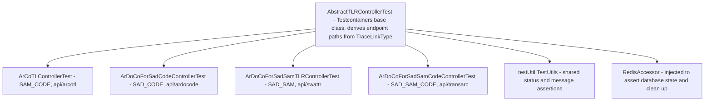
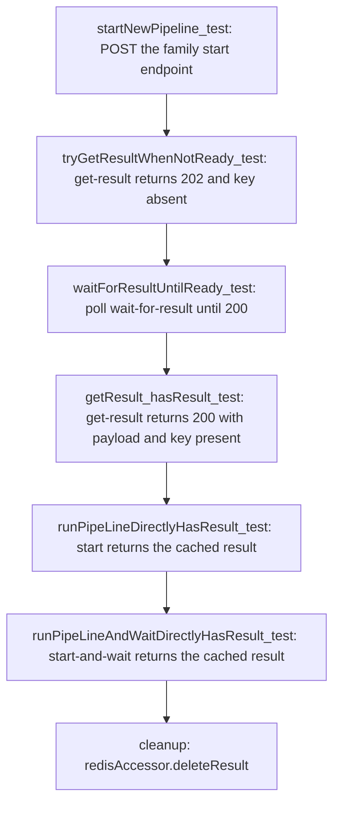

# Testing

The test tree of ArDoCo REST is small but deliberate: it combines full-stack controller integration tests against a real Redis container, a repository test for the Redis accessor, focused unit tests for the conversion utilities, and one ArchUnit rule that constrains the logging setup. Because the application's behavior is mostly request shaping, runner setup, asynchronous execution, Redis persistence, and response status selection, the tests are integration-heavy rather than mock-heavy — the controller tests run the actual ArDoCo runners against real project artifacts.

## Test organization

All tests live under `src/test/java` in two roots:

- `edu.kit.kastel.mcse.ardoco.tlr.rest` — the controller tests (`AbstractTLRControllerTest` plus four subclasses), the Redis tests (`RedisAccessorTest`, `RedisConnectionTest`, `RedisRealConnectionTest`), the utility tests (`FileConverterTest`, `HashGeneratorTest`, `TraceLinkConverterTest`), and `ArchitectureTest`.
- `testUtil` — `TestUtils`, a shared helper class for the controller tests.



*One abstract base class plus four per-family subclasses; `testUtil.TestUtils` holds the shared assertions, and the injected `RedisAccessor` doubles as a test oracle.*

Note the naming drift: the test class names (`ArDoCoForSadCodeControllerTest`, `ArDoCoForSadSamTLRControllerTest`, `ArDoCoForSadSamCodeControllerTest`) do not match the controller names (`ArDoCodeController`, `SwattrController`, `TransArCController`); see [Domains](domains.md#naming-notes) for the full mapping.

## The Testcontainers Redis pattern

The controller tests and `RedisAccessorTest` are `@SpringBootTest` classes that need a real Redis. They follow a common pattern instead of mocking the store:

1. A `@BeforeAll` method starts a `GenericContainer` of `redis:7.0-alpine` with exposed port 6379 (`RedisAccessorTest` additionally stops the container in `@AfterAll`).
2. The mapped host/port are injected via `System.setProperty("spring.data.redis.host", ...)` and `System.setProperty("spring.data.redis.port", ...)`, so the `LettuceConnectionFactory` in `ApplicationConfig` — which reads exactly those properties — connects to the container instead of a profile-configured host (`RedisAccessorTest` also sets the same pair via `@DynamicPropertySource`).
3. `AbstractTLRControllerTest` starts the application with `@SpringBootTest(classes = ArDoCoRestApplication.class, webEnvironment = RANDOM_PORT)` and exercises it through `TestRestTemplate` against `http://localhost:<port>`.

```java
redis = new GenericContainer<>(DockerImageName.parse("redis:7.0-alpine")).withExposedPorts(6379);
redis.start();
System.setProperty("spring.data.redis.host", redis.getHost());
System.setProperty("spring.data.redis.port", redis.getMappedPort(6379).toString());
```

The comment in `AbstractTLRControllerTest` shows a commented-out alternative using `@ServiceConnection` and `@DynamicPropertySource`; the active approach keeps the container shared across all subclasses of the base test. `RedisAccessorTest` combines both mechanisms (`System.setProperty` plus `@DynamicPropertySource`).

Because every Redis-backed test class provisions its own container, the suite requires a working local Docker daemon (or a remote Docker host), but it does **not** depend on the CI `redis` service container. The CI workflow (`.github/workflows/ci.yml`) runs `mvn verify` on `ubuntu-latest` with Java 21 and `SPRING_PROFILES_ACTIVE=docker`, and declares a `redis` service container published on port 6379 — the Testcontainers-based tests override the Redis host/port dynamically, so they bypass that service container. The Maven Failsafe plugin is bound to the `integration-test` and `verify` goals, so the full suite runs as part of the `mvn verify` lifecycle.

## Controller integration tests

### AbstractTLRControllerTest

`AbstractTLRControllerTest` is the abstract base class. It fixes the retrieval endpoints (`/api/get-result/{id}` and `/api/wait-for-result/{id}`) and derives the family endpoints from the `TraceLinkType` passed to the constructor: `/api/<endpointName>/start` and `/api/<endpointName>/start-and-wait` (e.g. `SAM_CODE` → `arcotl` → `/api/arcotl/start`). It injects the `RedisAccessor` and provides `resultIsInDatabase(id)` / `resultIsNotInDatabase(id)` assertions against the real Redis key space.

The main flow, `runPipeline_start_and_getResult`, drives the full lifecycle end to end:



*The start → poll → retrieve lifecycle asserted by `runPipeline_start_and_getResult`, ending with Redis cleanup.*

This asserts the dedup behavior of the API directly: re-running `start` and `start-and-wait` with the same inputs must return the cached result (HTTP 200 with `RESULT_IS_READY`) instead of dispatching a new pipeline, because the content-based request ID is unchanged. The test also asserts the key's absence in Redis before the pipeline finishes and its presence afterwards, tying the API response contract to the actual database state. `test_runPipelineAndWaitForResult_helper` accepts two legal outcomes for a fresh `start-and-wait` call: HTTP 200 with a ready result already in the database, or HTTP 202 with the `REQUEST_TIMED_OUT_START_AND_WAIT` message (the wait budget is `tlr.timeout.seconds`, 60 s) — in the latter case the test then polls `wait-for-result` until ready.

Each subclass supplies one abstract hook: `prepareRequestEntityForEmptyFileTest(projectName)` builds the multipart request for the empty-file rejection test.

### Subclass → family mapping

| Test class | `TraceLinkType` | Endpoint | Controller | Required multipart inputs |
| --- | --- | --- | --- | --- |
| `ArDoCoForSadCodeControllerTest` | `SAD_CODE` | `/api/ardocode` | `ArDoCodeController` | `inputText`, `inputCode` |
| `ArCoTLControllerTest` | `SAM_CODE` | `/api/arcotl` | `ArCoTLController` | `inputArchitectureModel`, `inputArchitectureModelFormat`, `inputCode` |
| `ArDoCoForSadSamTLRControllerTest` | `SAD_SAM` | `/api/swattr` | `SwattrController` | `inputText`, `inputArchitectureModel`, `inputArchitectureModelFormat` |
| `ArDoCoForSadSamCodeControllerTest` | `SAD_SAM_CODE` | `/api/transarc` | `TransArCController` | `inputText`, `inputArchitectureModel`, `inputArchitectureModelFormat`, `inputCode` |

There is **no controller test** for the `InconsistencyController` (`/api/find-inconsistencies`) — the inconsistency workflow has no dedicated test class. The subclasses build their requests with real `bigBlueButton` fixtures from `src/test/resources/bigBlueButton/` (`bigbluebutton.txt`, `codeModel.acm`, `bbb.repository` for PCM, `bbb.uml` for UML), so they exercise the actual `ModelFormat` binding and the actual ArDoCo runner setup, not mocked runners. The three architecture-model families (ArCoTL, SWATTR/sad-sam, and sad-sam-code) are each tested against both `ModelFormat.UML` and `ModelFormat.PCM`.

The subclass test methods carry `@Timeout(value = 3, unit = TimeUnit.MINUTES)` — the shared `runPipeline_start_and_getResult` helper in the base class is itself annotated with a 6-minute timeout, and the `ArDoCoForSadSamCodeControllerTest` PCM variants use 6 minutes, reflecting the heavier TransArC pipeline.

### Error paths

`AbstractTLRControllerTest` pins the two central rejection paths, via `TestUtils`:

- `testRetrievingResultForInvalidId` — querying `/api/get-result/{id}` and `/api/wait-for-result/{id}` with an unknown ID must both return `422 UNPROCESSABLE_CONTENT` with an `ErrorResponse` body.
- `testHandleEmptyFile` — posting an empty file (from `src/test/resources/emptyFile.txt`) to both `/start` and `/start-and-wait` must return `422 UNPROCESSABLE_CONTENT` with a `timestamp` present.

Each subclass then supplies its own empty-file fixture: the sad-code test empties the text, the ArCoTL test empties the architecture model, the sad-sam test empties the text, and the sad-sam-code test empties the text — i.e., each family's empty-file rejection is exercised on the input that family requires.

### testUtil.TestUtils

`TestUtils` is the assertion backbone of the controller tests. It:

- builds a multipart request for the bigBlueButton text + code fixture;
- parses a `ResponseEntity<String>` into an `ArdocoResultResponse` (reading `requestId`, `message`, `status`, `traceLinkType`, and the raw `traceLinks`/`inconsistencies` JSON);
- asserts the exact status/message/traceLinkType pairings for every flow using the `ResultMessages` constants: fresh start (`RESULT_IS_BEING_PROCESSED`), cached start (`RESULT_IS_READY`), not-ready get (`RESULT_NOT_READY` on `ACCEPTED`), ready get (`RESULT_IS_READY` on `OK`), timed-out wait (`REQUEST_TIMED_OUT`), ready wait (`RESULT_IS_READY`), and `start-and-wait` timeout (`REQUEST_TIMED_OUT_START_AND_WAIT`).

Because every pairing is asserted explicitly, changing a message constant, a status pairing, or the `traceLinkType` derivation breaks the build — the response model is pinned by these tests. The response model itself is documented in [Response and error model](concepts/response-and-error-model.md).

## Redis tests

`RedisAccessorTest` (`@SpringBootTest`) verifies the accessor semantics against the real Redis container:

- save-then-get round-trip with the id echoed back by `saveResult`;
- `keyExistsInDatabase` turning true after a save and `false` for unknown keys;
- `getResult` returning `null` for unknown keys;
- saving under an existing key overwriting the value;
- a `null` key raising `IllegalArgumentException` (thrown by the Redis template).

The details of `RedisAccessor` and its TTL behavior are documented in [Redis persistence integration](integrations/redis.md).

`RedisConnectionTest` and `RedisRealConnectionTest` exist but their bodies are **entirely commented out** — they are empty shells that provide no active coverage. Do not treat them as guards for the Redis connection; the live connection is exercised by `RedisAccessorTest` and the controller tests.

## Utility tests

The three utility tests pin the conversions that sit between the HTTP layer and the runner/Redis:

- **`FileConverterTest`** (uses `@TempDir` and `MockMultipartFile`): verifies `convertFilesToByte` concatenates the raw bytes of all files in list order (the byte stream that feeds the request-ID hash); that an empty file list throws `FileNotFoundException` with `"File list is empty"`; that an empty multipart upload throws `FileNotFoundException` with `"The file with name testfile.txt is empty."`; and that a `transferTo` failure throws `FileConversionException` with `"Error occurred while transferring the MultipartFile to File"`. The multipart-to-file conversion is the mechanism that creates the temporary files consumed by the pipeline.
- **`HashGeneratorTest`**: verifies identical file contents produce identical hashes, that a multi-file hash differs from the single-file hash of the same content, that different content produces different hashes, and that empty file lists (`FileNotFoundException`) and unreadable files (`FileConversionException`) raise the expected exceptions. This is the direct guard for the hash part of request-ID generation; see [Request IDs and result caching](concepts/request-ids-and-caching.md).
- **`TraceLinkConverterTest`**: pins that an empty trace-link list serializes to `"[]"` — the minimum shape the `@JsonRawValue` contract of `ArDoCoApiResult` relies on. (The converter's per-family payload shapes are documented in [Response and error model](concepts/response-and-error-model.md).)

## Architecture constraints

`ArchitectureTest` (`src/test/java/edu/kit/kastel/mcse/ardoco/tlr/rest/ArchitectureTest.java`) analyzes the `edu.kit.kastel.mcse.ardoco.tlr.rest` package with ArchUnit and enforces one rule:

```java
@ArchTest
static ArchRule disallowLog4j = noClasses().that()
        .haveNameNotMatching(ArchitectureTest.class.getName())
        .should()
        .dependOnClassesThat()
        .haveFullyQualifiedName(LogManager.class.getName())
        .orShould()
        .dependOnClassesThat()
        .haveFullyQualifiedName(Logger.class.getName());
```

In other words: **no class in the application may depend on Log4j classes (`org.apache.logging.log4j.LogManager` or `org.apache.logging.log4j.Logger`), except `ArchitectureTest` itself** — which imports Log4j classes precisely to reference them in the rule. New code must log through SLF4J (`org.slf4j.Logger` / `LoggerFactory`), which is what the production code uses. Adding a `log4j` import anywhere outside `ArchitectureTest` will fail the build. The ArchUnit dependency is not declared in the module POM; it comes through the `io.github.ardoco:parent` dependency chain.

## What to run after changes

When changing controllers, services, result handling, or repositories, prioritize the affected classes plus the shared tests they rely on:

- the relevant controller test subclass (`ArCoTLControllerTest`, `ArDoCoForSadCodeControllerTest`, `ArDoCoForSadSamTLRControllerTest`, or `ArDoCoForSadSamCodeControllerTest`) — or all of them, since `AbstractTLRControllerTest` changes affect every family;
- `RedisAccessorTest` when touching `RedisAccessor`, `DatabaseAccessor`, or the Redis configuration;
- `HashGeneratorTest` and `FileConverterTest` when touching request-ID generation or file conversion;
- `TraceLinkConverterTest` when touching the converter output shapes;
- `ArchitectureTest` when touching imports or the logging setup.

For broader changes, run the full Maven verification lifecycle: `mvn verify`, the same command CI uses. The integration tests require a Docker daemon (or a remote Testcontainers host) and each controller test spins up its own Redis container, so full-suite runs are relatively slow — the per-class timeouts are in the 3–6 minute range.

## Change-sensitive areas

| Area | Risk | Guarded by |
| --- | --- | --- |
| Request-ID generation | Any change to the hash or the ID format affects caching and result reuse; the controller tests assert the dedup behavior (cached start returns the ready result). | `HashGeneratorTest`, `FileConverterTest`, `AbstractTLRControllerTest` (cached-start assertions) |
| Temporary-file cleanup | `AbstractRunnerTLRService.runPipelineAsync` deletes all input files in a `finally` block; a failure there can leak files or break async cleanup. No test directly asserts the deletion, but the controller integration tests exercise the real pipeline path that creates and consumes the temp files, and `FileConverterTest` pins the conversion that creates them. | `FileConverterTest`, controller integration tests (indirectly) |
| Redis serialization | `RedisAccessor` stores plain strings; the read path (`AbstractService.getResultFromDatabase`) re-parses the stored `traceLinks`/`inconsistencies` shape. A mismatch changes how results are retrieved later. | `RedisAccessorTest`, `TraceLinkConverterTest`, controller integration tests (database-state assertions at each stage) |
| Response status selection | Start, wait, and timeout behavior is part of the public API contract; the status/message pairings are asserted exactly. | `testUtil.TestUtils`, `AbstractTLRControllerTest` (`testRetrievingResultForInvalidId`, `testHandleEmptyFile`, `test_runPipelineAndWaitForResult_helper`) |

## Source references

- `src/test/java/edu/kit/kastel/mcse/ardoco/tlr/rest/api/controller/AbstractTLRControllerTest.java`
- `src/test/java/edu/kit/kastel/mcse/ardoco/tlr/rest/api/controller/ArCoTLControllerTest.java`
- `src/test/java/edu/kit/kastel/mcse/ardoco/tlr/rest/api/controller/ArDoCoForSadCodeControllerTest.java`
- `src/test/java/edu/kit/kastel/mcse/ardoco/tlr/rest/api/controller/ArDoCoForSadSamCodeControllerTest.java`
- `src/test/java/edu/kit/kastel/mcse/ardoco/tlr/rest/api/controller/ArDoCoForSadSamTLRControllerTest.java`
- `src/test/java/edu/kit/kastel/mcse/ardoco/tlr/rest/api/RedisConnectionTest.java`
- `src/test/java/edu/kit/kastel/mcse/ardoco/tlr/rest/api/RedisRealConnectionTest.java`
- `src/test/java/edu/kit/kastel/mcse/ardoco/tlr/rest/api/repository/RedisAccessorTest.java`
- `src/test/java/edu/kit/kastel/mcse/ardoco/tlr/rest/api/util/FileConverterTest.java`
- `src/test/java/edu/kit/kastel/mcse/ardoco/tlr/rest/api/util/HashGeneratorTest.java`
- `src/test/java/edu/kit/kastel/mcse/ardoco/tlr/rest/api/util/TraceLinkConverterTest.java`
- `src/test/java/testUtil/TestUtils.java`
- `src/test/java/edu/kit/kastel/mcse/ardoco/tlr/rest/ArchitectureTest.java`
- `.github/workflows/ci.yml`

## Related pages

- [Architecture](architecture.md) — the layering and request lifecycle the controller tests exercise.
- [Domains](domains.md) — the runner families and the naming drift between test classes and controllers.
- [Request IDs and result caching](concepts/request-ids-and-caching.md) — the dedup behavior the controller tests assert.
- [Response and error model](concepts/response-and-error-model.md) — the status/message pairings pinned by `TestUtils`.
- [Redis persistence integration](integrations/redis.md) — the persistence layer behind `RedisAccessorTest` and the controller tests.
- [ArDoCo runner integration](integrations/ardoco-runners.md) — why the controller tests double as the ArDoCo compatibility check.
- [Workflow: pipeline execution](workflows/pipeline-execution.md) — the lifecycle the tests drive.
- [Workflow: result retrieval](workflows/result-retrieval.md) — the client-side retrieval experience the retrieval tests pin.
