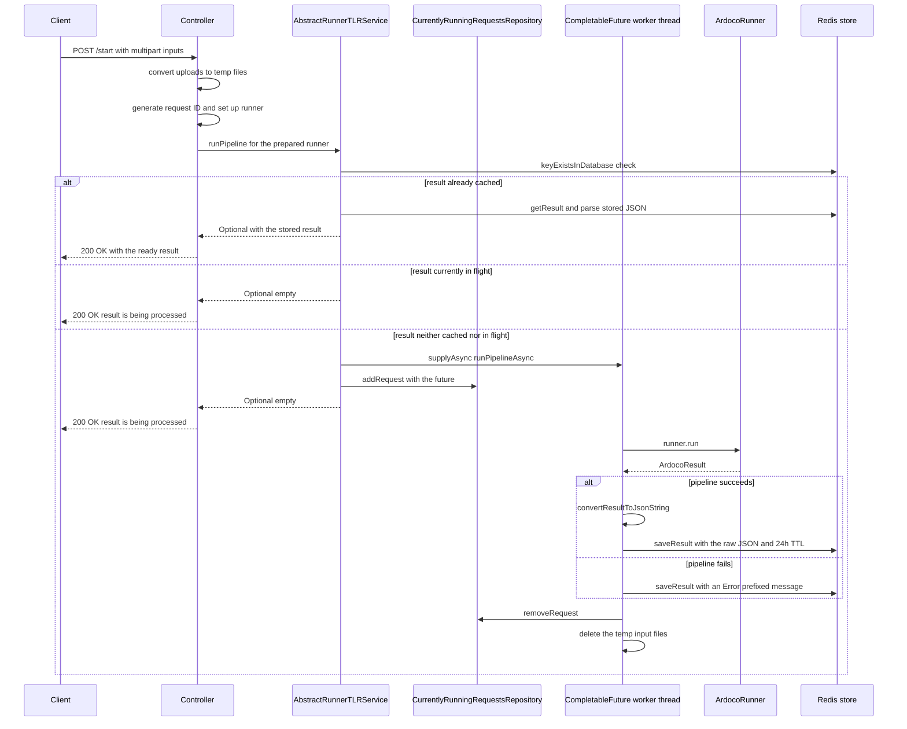

# Workflow: pipeline execution

Every `/start` and `/start-and-wait` endpoint of the five runner families executes through the same path: the controller shapes the request **synchronously** (file conversion, request-ID generation, runner setup), the service decides whether a run is needed at all by checking Redis and the in-flight registry, and only the direct ArDoCo invocation is dispatched **asynchronously**. Both start endpoints answer HTTP 200 immediately — with the cached result when one exists, otherwise with "The result is being processed and can be queried using the id." — so no client ever waits inside a `/start` call for ArDoCo to finish.

Two stores cooperate in this flow with different lifetimes: the in-flight registry `CurrentlyRunningRequestsRepository` (in-memory, process-lifetime) tracks running pipelines, and the `DatabaseAccessor`/`RedisAccessor` key-value store (durable, 24h TTL) holds finished results and error markers. How the request ID that keys both stores is built is covered in [Request IDs and result caching](../concepts/request-ids-and-caching.md); this page documents what happens around it.

## Phase 1: synchronous request shaping

Each family controller (`ArDoCodeController` is the example; the shape is identical in `ArCoTLController`, `SwattrController`, `TransArCController`, and `InconsistencyController`) performs four steps in its `runPipeline` and `runPipelineAndWaitForResult` methods:

1. **Convert the multipart uploads to local temp files.** `FileConverter.convertMultipartFileToFile` writes each upload to `System.getProperty("java.io.tmpdir")` under its original filename and rejects `null` or empty uploads (`FileNotFoundException`/`FileConversionException`, both mapped to 422). The resulting `File` objects form the `inputFiles` list that travels through the whole flow and is deleted in the cleanup phase.
2. **Parse the optional `additionalConfigs` JSON** with `AbstractController.parseAdditionalConfigs` into a `TreeMap<String, String>`; invalid JSON raises `FileConversionException` (422).
3. **Generate the content-based request ID** with `AbstractController.generateRequestId`: `traceLinkType.getKeyPrefix() + ":" + projectName + <hash>`, where the hash comes from `HashGenerator.getMD5HashFromFiles` over the concatenated bytes of all input files. `InconsistencyController` overrides this to insert an `Inconsistency` segment after the prefix. Details and client consequences: [Request IDs and result caching](../concepts/request-ids-and-caching.md).
4. **Instantiate and configure the runner** — e.g. `new Ardocode(projectName)` plus `runner.setUp(..., Files.createTempDirectory("ardoco-sad-code").toFile())`. The required output directory is a throwaway per-request temp directory; the per-family `setUp` signatures are documented in [ArDoCo runner integration](../integrations/ardoco-runners.md).

All of this runs in the request thread, by design: "only the direct interaction with ardoco is asynchronous. Handling the input file (including conversion and checking whether its file type is correct) is done before, since like this the user can get quicker feedback that something went wrong" (`architecture_decisions.md`). Every failure in this phase therefore surfaces as a 422 error response before any ArDoCo work starts.

One placement detail matters for anyone refactoring the service layer: **runner setup happens before the dedup check**. A fully configured runner is built even when the result is already cached and only needs to be read back. This is a documented trade-off — each runner's `setUp` takes different parameters, so moving the setup behind a unified service interface was rejected as too much generics complexity (see [Architecture](../architecture.md) and `architecture_decisions.md`).

## Phase 2: the dedup check

`AbstractRunnerTLRService.runPipeline(runner, id, inputFiles)` makes the run-or-reuse decision:

```java
if (!resultIsInDatabase(id) && !resultIsOnItsWay(id)) {
    // dispatch a new asynchronous run
} else if (resultIsInDatabase(id)) {
    return Optional.of(getResultFromDatabase(id));
}
return Optional.empty();
```

The two predicates come from `AbstractService`:

- `resultIsInDatabase(id)` → `DatabaseAccessor.keyExistsInDatabase(id)` — a Redis `EXISTS` via `RedisAccessor`.
- `resultIsOnItsWay(id)` → `CurrentlyRunningRequestsRepository.containsRequest(id)` — an in-memory map lookup.

Three outcomes are possible:

| State | `runPipeline` returns | Client-visible effect |
| --- | --- | --- |
| Result already stored in Redis | `Optional.of(getResultFromDatabase(id))` | Start endpoint responds 200 with the cached payload and "The result is ready." |
| Result currently in flight | `Optional.empty()` | No second run is dispatched; 200 with the "being processed" message |
| Neither | dispatch + `Optional.empty()` | New run starts; 200 with the "being processed" message |

Two ordering subtleties: the durable store is consulted first and the registry second, so a run that just completed (entry removed, value saved) is served from the cache. And the check-then-act sequence is **not atomic** — two concurrent first requests for the same brand-new ID can each dispatch a run before either future is registered. The system converges (the later `saveResult` overwrites the earlier one), but one run may be wasted. The dispatch itself widens this window slightly: the future is created (`CompletableFuture.supplyAsync`) *before* it is registered (`addRequest`).

## Phase 3: dispatch and in-flight tracking

A new run is wrapped in `CompletableFuture.supplyAsync(() -> runPipelineAsync(runner, id, inputFiles))`, which executes on the ForkJoin common pool, and the future is registered under the request ID in `CurrentlyRunningRequestsRepository`. That repository is a singleton-scoped `@Repository` over a `ConcurrentHashMap<String, CompletableFuture<ArDoCoApiResult>>` — purely in-memory application state. The registration is what makes the rest of the API cheap:

- `ResultService.getResult` can skip the database call entirely while a run is in flight (`resultIsOnItsWay` → `Optional.empty()` → 202).
- `ResultService.waitForResult` can block on the registered future (`future.get(secondsUntilTimeout, SECONDS)`) instead of polling Redis.

Although `ArDoCoRestApplication` carries `@EnableAsync`, this flow does not use `@Async` handler methods — the dispatch is plain `CompletableFuture.supplyAsync`. The map is lost on a process restart, which is harmless: durable results live in Redis, and unfinished pipelines die with the process anyway.

## Phase 4: what the client gets back

`AbstractController` turns the service result into the response:

- `handleRunPipeLineResult` (used by `/start`): an empty `Optional` produces `200 OK` with `ResultMessages.RESULT_IS_BEING_PROCESSED` ("The result is being processed and can be queried using the id."); a present one produces `200 OK` with the payload and `RESULT_IS_READY` ("The result is ready."). **Both outcomes are HTTP 200** — the request ID in the body is the contract for later polling.
- `handleRunPipelineAndWaitForResult` (used by `/start-and-wait`): the same service call, then — only when the result was empty — a bounded block in `ResultService.waitForResult(id)` for `tlr.timeout.seconds` (60 seconds by default in `application.properties`). A result arriving in time yields `200 OK` with the payload; a timeout yields `202 Accepted` with `REQUEST_TIMED_OUT_START_AND_WAIT` ("The request timed out before the traceLinks could be retrieved. Please try querying only the result using the projectId."). If the run finished between the two service calls, `waitForResult` finds the registry empty and reads the result from Redis directly.

The polling and waiting experience after the start response is documented in [Workflow: result retrieval and waiting](result-retrieval.md).

## Phase 5: asynchronous execution and the Redis save

`runPipelineAsync` runs on the worker thread:

1. `runner.run()` executes the ArDoCo pipeline and returns an `ArdocoResult`.
2. `convertResultToJsonString(result)` — abstract, implemented per family — converts the runner-specific trace links (via `TraceLinkConverter`; `InconsistencyService` additionally converts the inconsistencies via `InconsistencyConverter`) into an `ArDoCoApiResult`.
3. `databaseAccessor.saveResult(id, traceLinkJson.buildJsonString())` stores the **raw JSON string** — `{"traceLinks":...,"inconsistencies":...}` — under the request ID, with the 24-hour TTL applied by `RedisAccessor` from `redis.time-to-live.hours`.

The conversion therefore happens exactly once per run; every later retrieval re-parses the stored string instead of re-converting (the stored and response shapes must stay in sync — see [Response and error model](../concepts/response-and-error-model.md) and [Redis persistence integration](../integrations/redis.md)).

## The failure path: an error marker, not a missing key

Any exception inside the asynchronous pipeline is caught, logged, and handled as follows:

```java
} catch (Exception e) {
    String message = String.format("Error occurred while running the pipeline asynchronously for ID %s : %s", id, e.getMessage());
    logger.error(message, e);
    databaseAccessor.saveResult(id, ERROR_PREFIX + message);
    throw new ArdocoException(message, e);
}
```

`ERROR_PREFIX` is `"Error: "`. This produces the page's key failure invariant: **a failed pipeline still writes a value into Redis under the request ID, with the normal 24-hour TTL** — it does not leave the key absent. On the read side, `AbstractService.getResultFromDatabase` throws `ArdocoException` when the stored value is `null` or starts with `ERROR_PREFIX`, and `GlobalExceptionHandler` maps `ArdocoException` to HTTP 500. So a later `getResult` call surfaces the stored failure as an `ArdocoException` (500) rather than the missing-key `IllegalArgumentException` (422) — and because re-POSTed `/start` requests are served from the cached branch, a repeated start within the TTL window returns the cached failure as 500 too, without re-running the pipeline. To retry a failed run with identical inputs, the key must expire or be deleted (see [Request IDs and result caching](../concepts/request-ids-and-caching.md)).

The rethrown exception is observed differently by the two start endpoints:

- **`/start` never consumes the future.** Nothing calls `get()` on it, so the rethrown `ArdocoException` goes unnoticed by the request thread; the failure surfaces only later, through the Redis error marker, when the client retrieves the result.
- **`/start-and-wait` is blocked on the future.** The exceptional completion arrives as an `ExecutionException` in `waitForResultHelper`, which is rethrown as `ArdocoException` — the client gets the 500 immediately.

Either way the error marker is already in Redis when the exception propagates, because the save happens in the `catch` block before the `finally` cleanup.

## Guaranteed cleanup: the finally block

`runPipelineAsync` closes with:

```java
} finally {
    currentlyRunningRequestsRepository.removeRequest(id);
    for (File file : inputFiles) {
        file.delete();
    }
}
```

This block runs on **both the success and failure paths** (and on interruption), which establishes two invariants:

1. **The in-flight registry self-heals.** No entry outlives its future's terminal state, so `containsRequest` never reports a finished run as still running (barring a process restart).
2. **Temp input files of dispatched runs never leak.** Every `File` in the `inputFiles` list — the temp files created in phase 1 — is deleted after the pipeline ends, whether it produced a result or an error marker.

One coverage caveat: the cleanup starts at dispatch. If the request thread fails *between* temp-file conversion and the dispatch — for example when `runner.setUp` throws `IOException` while creating the per-request temp output directory — the already-written temp input files are not cleaned up by this flow, because the `finally` block was never entered and nothing else deletes them. The runner's output temp directory is never deleted by application code at all; it is left to the JVM's own temp-file handling (see [ArDoCo runner integration](../integrations/ardoco-runners.md)).

## The flow end to end



*Async pipeline execution from the start request through the dedup check, the worker thread, Redis, and the always-running cleanup; the client's 200 response leaves long before `runner.run` completes.*

## What the tests pin

`AbstractTLRControllerTest` and its per-family subclasses exercise this flow against a real Redis (`redis:7.0-alpine` via Testcontainers) and real ArDoCo runners:

- `runPipeline_start_and_getResult` pins the full sequence: `/start` returns the ID; `get-result` while the run is in flight answers not-ready **and the Redis key does not exist yet** (no partial writes during execution); `wait-for-result` polls until the key exists; `get-result` then returns the payload; and re-POSTing `/start` or `/start-and-wait` afterwards is served from the database — the cached dedup branch.
- `testHandleEmptyFile` pins the synchronous validation boundary: both start endpoints reject an empty upload with a 422 before any ArDoCo work.
- `testRetrievingResultForInvalidId` pins the error path for unknown IDs.

The broader test organization is described in [Testing](../testing.md).

## Related pages

- [Architecture](../architecture.md) — the layering and the request lifecycle this workflow implements.
- [Request IDs and result caching](../concepts/request-ids-and-caching.md) — how the ID is built and the dedup/TTL consequences for clients.
- [Workflow: result retrieval and waiting](result-retrieval.md) — polling, bounded waiting, and how stored errors resurface.
- [ArDoCo runner integration](../integrations/ardoco-runners.md) — the runner classes and `setUp` signatures configured in phase 1.
- [Redis persistence integration](../integrations/redis.md) — the durable store that receives the results and error markers.
- [Response and error model](../concepts/response-and-error-model.md) — the response envelope and exception-to-status mapping.
- [Testing](../testing.md) — the Testcontainers-based controller tests that pin this flow.
- `architecture_decisions.md` (repository root) — the documented trade-offs: controller-side runner setup, async-only ArDoCo invocation, and the in-flight `ConcurrentHashMap`.
