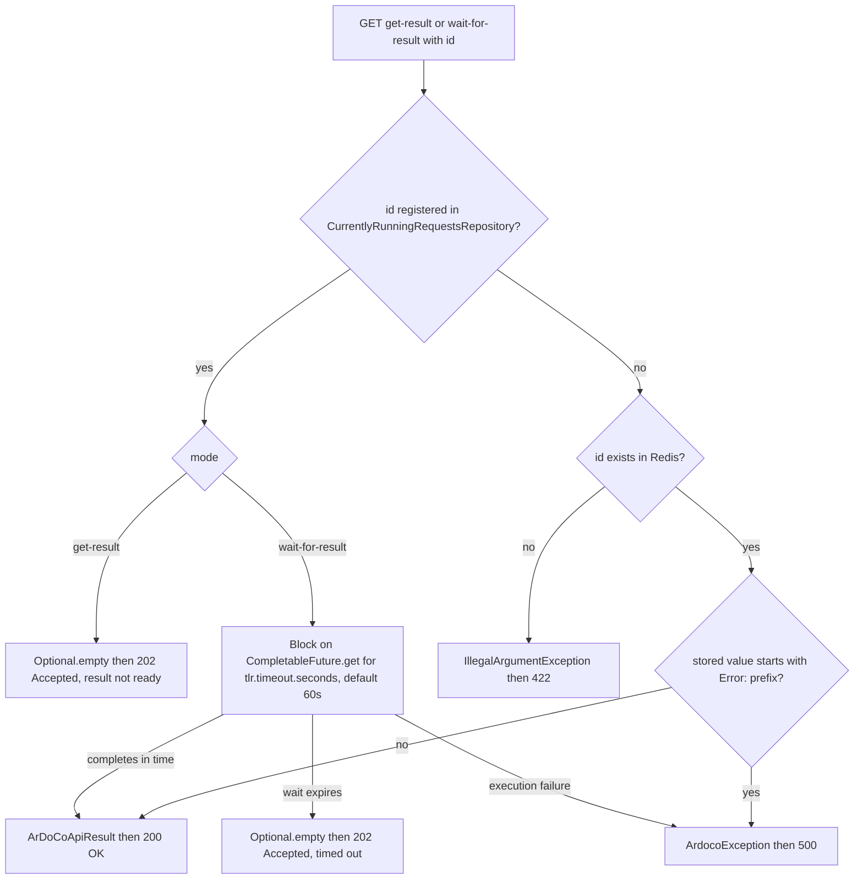

# Workflow: result retrieval and waiting

After a pipeline has been started (see [Workflow: pipeline execution](pipeline-execution.md)), the client holds a request ID such as `ardocodeResult:bigbluebutton67c34469-…` and uses it to obtain the result in one of three ways: the `start-and-wait` endpoint already blocks for it, `GET /api/get-result/{id}` polls without blocking, and `GET /api/wait-for-result/{id}` blocks on a later call. All three funnel through the same `ResultService` and the same response convention: **a present `Optional<ArDoCoApiResult>` becomes HTTP 200 with the payload; an empty one becomes 202 Accepted with an explanatory message**. Only genuine failures — unknown IDs and stored pipeline errors — produce error responses (422 and 500).

## The retrieval endpoints

`ResultController` (in `src/main/java/edu/kit/kastel/mcse/ardoco/tlr/rest/api/controller/ResultController.java`) exposes the two shared retrieval endpoints under `@RequestMapping("/api")`:

- `GET /api/get-result/{id}` — non-blocking query. Returns the result if it is in Redis, otherwise 202 with `"Result is still being processed. Please try again later."` (`ResultMessages.RESULT_NOT_READY`).
- `GET /api/wait-for-result/{id}` — blocking query, documented as "waits up to 60s". Returns the result when the previously started pipeline finishes within the wait budget, otherwise 202 with `"The request timed out before the traceLinks could be retrieved. Please try again using the projectId."` (`ResultMessages.REQUEST_TIMED_OUT`).

Both are **cross-family**: they serve any family's result because the request ID is self-describing (see [Request IDs and result caching](../concepts/request-ids-and-caching.md)), and `ArdocoResultResponse` recovers the `traceLinkType` from the ID via `TraceLinkType.fromId(id)`. The controllers declare `ArdocoException` and `IllegalArgumentException` in their signatures; these are handled by the `GlobalExceptionHandler` rather than returned inline.

The two handlers differ only in the service call they make and the message used on the empty case:

```java
// handleGetResult
Optional<ArDoCoApiResult> result = service.getResult(requestId);
if (result.isEmpty()) {
    response = new ArdocoResultResponse(requestId, HttpStatus.ACCEPTED, ResultMessages.RESULT_NOT_READY);
} else {
    response = new ArdocoResultResponse(requestId, HttpStatus.OK, result.get(), ResultMessages.RESULT_IS_READY);
}
```

`handleWaitForResult` is identical except that it calls `service.waitForResult(requestId)` and uses `REQUEST_TIMED_OUT` as the empty-case message. In both handlers the `ResponseEntity` status is taken from the response envelope itself (`new ResponseEntity<>(response, response.getStatus())`), so the HTTP status always equals the envelope's `status` field.

## The third mode: start-and-wait

The start-and-wait endpoints do not use `ResultController` at all. `AbstractController.handleRunPipelineAndWaitForResult` calls `service.runPipeline(runner, requestId, inputFiles)` first; only when that returns an empty `Optional` (no cached result, run just dispatched) does it call `resultService.waitForResult(requestId)` — the same `ResultService` method the wait endpoint uses. The timeout outcome differs only in its message: 202 Accepted with `REQUEST_TIMED_OUT_START_AND_WAIT` ("… Please try querying only the result using the projectId."), directing the client to switch to polling with the ID it already holds.

## ResultService: the retrieve/wait decision path

`ResultService` (in `rest/api/service/ResultService.java`) implements both operations against the two stores — the in-memory in-flight registry `CurrentlyRunningRequestsRepository` and the durable `DatabaseAccessor` (Redis):

- `getResult(id)`: if `resultIsOnItsWay(id)` (the ID is registered as a running `CompletableFuture`), return `Optional.empty()` immediately — the database is not even consulted. Otherwise return `Optional.of(getResultFromDatabase(id))`.
- `waitForResult(id)`: if the result is in flight, block on it via `waitForResultHelper`; if not, return `getResultFromDatabase(id)` directly. This means a run that finished between the start response and the wait call (future deregistered, result saved) is served from Redis without waiting.

`waitForResultHelper` is the only place a timeout is actually produced:

```java
return Optional.of(currentlyRunningRequestsRepository.getRequest(id).get(secondsUntilTimeout, TimeUnit.SECONDS));
```

`secondsUntilTimeout` is injected from the `tlr.timeout.seconds` property — **60 seconds** by default in `application.properties`. A `java.util.concurrent.TimeoutException` from `Future.get` is caught and converted into `Optional.empty()`, which the controller turns into **202 Accepted** — it is *not* an error response. An `ExecutionException` or `InterruptedException` is instead wrapped in `ArdocoException`, which surfaces as HTTP 500.



*The retrieve/wait decision path of `ResultService`: in-flight check, bounded wait, Redis lookup, and the two error exits.*

## Reading from the database: the failure and deserialization contract

`AbstractService.getResultFromDatabase(id)` (in `rest/api/service/AbstractService.java`) is the single read path for finished results, and it has two ordered failure checks:

1. **Unknown or expired ID.** If `resultIsInDatabase(id)` is false (`DatabaseAccessor.keyExistsInDatabase` — a Redis `EXISTS`), it throws `IllegalArgumentException(String.format("No result with key %s found.", id))`. The `GlobalExceptionHandler` maps `IllegalArgumentException` to **422 Unprocessable Content**. This is the response a client gets for a mistyped ID or one whose 24-hour Redis TTL has expired — and it is distinct from the 202 that a still-running pipeline yields.
2. **Stored pipeline error.** If the stored value is `null` or starts with `ERROR_PREFIX` (`"Error: "`), it throws `ArdocoException(result)`. The handler maps `ArdocoException` to **500 Internal Server Error**. This is the key failure invariant of the retrieval side: a failed pipeline wrote an error marker into Redis under the request ID (with the normal 24-hour TTL) rather than leaving the key absent, so the failure resurfaces as a 500 on every retrieval until the TTL expires — re-running the same inputs does not clear it (see [Workflow: pipeline execution](pipeline-execution.md#the-failure-path-an-error-marker-not-a-missing-key)).

3. **Deserialization.** Otherwise the stored JSON string is re-parsed and re-hydrated:

```java
ObjectMapper mapper = new ObjectMapper();
JsonNode root = mapper.readTree(result);
String traceLinks = root.path("traceLinks").toString();
String inconsistencies = root.path("inconsistencies").toString();
return new ArDoCoApiResult(traceLinks, inconsistencies);
```

The stored shape is exactly what `ArDoCoApiResult.buildJsonString()` wrote at save time: `{"traceLinks":<raw>,"inconsistencies":<raw>}`. The contract is therefore **name-based**: the reader extracts the `traceLinks` and `inconsistencies` nodes by name and rebuilds an `ArDoCoApiResult`, whose `@JsonRawValue`-annotated fields embed the raw JSON verbatim in the HTTP response (see [Response and error model](../concepts/response-and-error-model.md#the-result-payload-ardocoapiresult-and-jsonrawvalue)). Renaming either the keys written by `buildJsonString()` or the node names read here breaks retrieval; any parse failure is wrapped as `ArdocoException("Failed to deserialize JSON result for ID " + id + …)` and thus surfaces as a 500.

## The timeout nuance

A custom `edu.kit.kastel.mcse.ardoco.tlr.rest.api.exception.TimeoutException` exists and `GlobalExceptionHandler` maps it to **408 Request Timeout**, but the exception is never constructed in the current code. The real waiting path is `waitForResultHelper`, which catches `java.util.concurrent.TimeoutException` internally and returns `Optional.empty()` — so the observable behavior of an expired wait is **202 Accepted**, never 408. The 408 handler remains a defensive path should a `TimeoutException` ever propagate out of a controller signature (several declare it, including `ResultController.waitForResult`).

## What clients should implement

- **Polling client:** start the pipeline, keep the `requestId` from the 200 start response, then `GET /api/get-result/{id}` in a loop; treat `202` as "try again later" and `200` as final. An unknown/expired ID aborts with 422.
- **Waiting client:** use `start-and-wait` (bounded block at start) or `GET /api/wait-for-result/{id}` (bounded block at retrieval). Treat `202` as "the pipeline is still running — switch to polling with the ID"; the message text states this explicitly. Never treat 202 as an error: the pipeline is alive and its result will appear in Redis when it finishes.
- **Error handling:** a 500 with a message beginning `Error: …` means the pipeline itself failed; retrying with identical inputs within the TTL window returns the same cached failure, so change an input (or the key must expire) to trigger a fresh run.

## Testing

The retrieval behavior is pinned by the controller integration tests, which run against a live Redis container (`redis:7.0-alpine` via Testcontainers) in `AbstractTLRControllerTest`:

- `testRetrievingResultForInvalidId` exercises the unknown-ID path end to end on **both** retrieval endpoints and asserts 422 Unprocessable Content.
- `waitForResultUntilReady_test` loops `GET /api/wait-for-result/{id}`, asserting the 202/`REQUEST_TIMED_OUT` pairing on every expired wait until a 200/`RESULT_IS_READY` arrives — the bounded wait is exercised repeatedly rather than assumed.
- `tryGetResultWhenNotReady_test` asserts the 202/`RESULT_NOT_READY` pairing immediately after a fresh start, and `test_runPipelineAndWaitForResult_helper` asserts that a start-and-wait call either returns 200 with a payload or 202 with `REQUEST_TIMED_OUT_START_AND_WAIT`, then verifies the result via `get-result` afterwards.

The exact status/message/result pairings are asserted in `testUtil.TestUtils` (`testGetResult_notReady`, `testGetResult_ready`, `testWaitForResult_notReady`, `testWaitForResult_ready`, `testRunPipelineAndWaitForResult_notReady`, `testInvalidRequestId`), so changing a `ResultMessages` constant or a status pairing breaks the build. See [Testing](../testing.md) for how the tests are organized.

## Related pages

- [Workflow: pipeline execution](pipeline-execution.md) — how a run is dispatched, tracked in flight, and its result (or error marker) saved to Redis.
- [Request IDs and result caching](../concepts/request-ids-and-caching.md) — how the request ID is built, why it enables dedup, and the 24h TTL that bounds key lifetime.
- [Response and error model](../concepts/response-and-error-model.md) — the `ArdocoResultResponse`/`ErrorResponse` schemas and the full status/message matrix.
- [Domains](../domains.md) — the runner families whose results these endpoints serve.
- [Testing](../testing.md) — the controller test hierarchy and what to run after changes.
